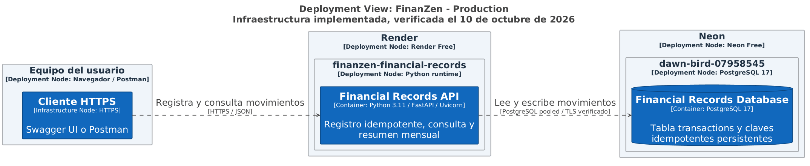

# C4 Deployment de FinanZen

Fuente editable: [deployment.dsl](deployment.dsl). Modelo validado mediante
Structurizr CLI **2025.11.09**; [validación](../evidencias/cierre-sprint-1/structurizr-validation.txt)
y [export](../evidencias/cierre-sprint-1/structurizr-export.txt).



[SVG](deployment.svg) y [PlantUML exportado](export/structurizr-FinanZenDeployment.puml).
PlantUML **1.2026.8** renderizó la vista exportada, utilizando Smetana para
el layout. El diagrama identifica nodos de despliegue, instancias de la API
y la base de datos, cliente HTTPS y protocolos de comunicación.

Desde esta carpeta, con Docker:

```powershell
docker run --rm -v "${PWD}:/usr/local/structurizr" structurizr/cli:2025.11.09 validate -workspace deployment.dsl
docker run --rm -v "${PWD}:/usr/local/structurizr" structurizr/cli:2025.11.09 export -workspace deployment.dsl -format plantuml -output export
```

El render se realizó localmente; no se subieron credenciales a servidores de
diagramación. Los recursos representados son Render Free y Neon Free reales,
documentados en los registros del despliegue. La elección de proveedor frente
al statement se explica en 5.2.4 y no se presenta como aprobada por el docente.
