# Capítulo V: Product Implementation, Validation & Deployment

[Volver al informe](../README.md) · Fuente: páginas físicas 95–109 del PDF,
actualizada con el código y la validación de esta entrega.

Esta ampliación documenta el **Financial Records Service** existente: registro
de ingresos/egresos, consulta de movimientos y resumen mensual. Los requisitos
de evidencia se contrastan con `Trabajo Final_1ASI0657_202620.docx`, proporcionado
como statement. Las propuestas y las capturas pendientes se distinguen de las
evidencias ya obtenidas. Consultar la [guía de evidencias del Sprint 1](../evidencias/sprint-1/README.md).

## 5.1. Testing Suites & General Patterns

### 5.1.1. Backend Application Core Testing Suite

El núcleo utiliza Python, FastAPI y Pydantic, con SQLite local o PostgreSQL
mediante `DATABASE_URL`. Las pruebas utilizan pytest/TestClient: cinco casos
con SQLite temporal y tres con PostgreSQL 17 real. Estos últimos usan usuarios
de muestra únicos y una base de validación separada.

La suite actual está en [back/tests/test_api.py](https://github.com/1ASI0657-2620-9199/back/blob/main/tests/test_api.py):

| Prueba actual | Comportamiento comprobado | Relación con el PDF |
| --- | --- | --- |
| `test_create_is_idempotent_and_rejects_key_reuse` | HTTP 201, repetición HTTP 200 con el mismo ID y conflicto HTTP 409 | Corresponde al comportamiento llamado `test_idempotency_and_conflict` en la fuente |
| `test_summary_calculates_balance_and_isolates_users` | Ingresos, gastos, saldo y filtrado por usuario | Corresponde a `test_summary_balance_and_user_isolation` en la fuente |
| `test_frontend_is_served` | Entrega de una interfaz desde una ruta configurable | Prueba de entrega estática, independiente de incluir el frontend en el paquete del backend |
| `test_backend_runs_without_frontend` | Health/Swagger disponibles sin archivos del cliente | Añadida durante la separación del proyecto |
| `test_transactions_survive_application_restart` | Datos e idempotencia sobreviven al recrear la aplicación con SQLite | Nueva evidencia de persistencia |
| `test_postgres_transactions_summary_and_isolation` | Registro, resumen, aislamiento, repetición y conflicto en PostgreSQL | Nueva integración con PostgreSQL |
| `test_postgres_data_and_idempotency_survive_application_restart` | Persistencia e idempotencia al recrear la aplicación con PostgreSQL | Nueva evidencia de persistencia |
| `test_concurrent_postgres_replays_create_only_one_movement` | Ocho solicitudes concurrentes crean un solo movimiento | Nueva prueba de concurrencia idempotente |

El PDF describe tres pruebas con los nombres históricos anteriores. Esta
versión documenta ocho pruebas reales. Los tres casos PostgreSQL están en
[tests/test_postgres.py](https://github.com/1ASI0657-2620-9199/back/blob/f218113d0e8cc4f2f431d4573eac40e47cbb0ee3/tests/test_postgres.py). Los resultados y
comandos ejecutados se registran en [validación](../evidencias/validacion.md).

El filtrado por `X-User-Id` comprueba aislamiento lógico para una identidad
indicada por el cliente. No demuestra autenticación ni autorización real.
Tampoco se ejecutan escenarios de carga, telemetría, proyecciones o auditoría.

Para futuros incrementos, el PDF propone separar pruebas unitarias,
integración, persistencia y contratos. Esa estructura sigue siendo una propuesta;
la suite actual separa pruebas de API y de integración con PostgreSQL.

Para repetir la suite desde `back`:

```powershell
python -m pytest -q -p no:cacheprovider
```

Para ejecutar los ocho casos, `TEST_DATABASE_URL` debe apuntar a una base
PostgreSQL exclusiva de pruebas; sin esa variable, tres casos se omiten.
El workflow configura PostgreSQL 17 como servicio de CI.
La ejecución del 10 de octubre de 2026 produjo **8 passed in 1.43s**:
[salida real](../evidencias/deployment/local/pytest.txt) y
[vista del registro](../evidencias/deployment/local/02-pytest.png).
El resultado anterior de cuatro pruebas se conserva como evidencia histórica.
Los escenarios BDD siguen pendientes; consultar 5.3.1.3.

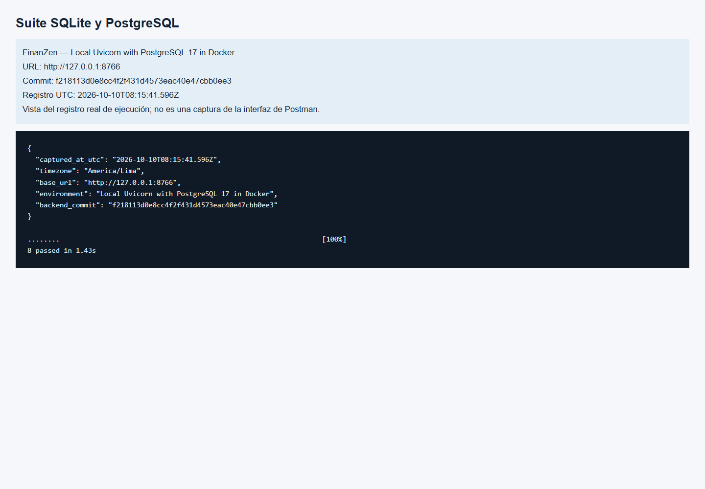

### 5.1.2. Pattern Based Backend Application(s)

Repository está implementado en `FinancialRecordsRepository`. Los contratos
REST se exponen bajo `/api/v1`, y FastAPI genera OpenAPI/Swagger.
La persistencia usa una única tabla de transacciones en SQLite o PostgreSQL.

| Elemento | Responsabilidad | Código |
| --- | --- | --- |
| `app/main.py` | Rutas HTTP, cabeceras, respuestas y composición de la aplicación | [Endpoints](https://github.com/1ASI0657-2620-9199/back/blob/6ff8141000371271d8b91ebc8d0b7ed5fdea1906/app/main.py) |
| `app/models.py` | Contratos Pydantic para validar movimientos y representar respuestas | [Modelos](https://github.com/1ASI0657-2620-9199/back/blob/6ff8141000371271d8b91ebc8d0b7ed5fdea1906/app/models.py) |
| `FinancialRecordsRepository` | Esquema, inserción, consulta y cálculo del resumen | [Repository](https://github.com/1ASI0657-2620-9199/back/blob/6ff8141000371271d8b91ebc8d0b7ed5fdea1906/app/repository.py) |
| `Database` / `DatabaseSession` | Adaptación de conexiones, parámetros SQL y transacciones para SQLite/PostgreSQL | [Adaptador actual](https://github.com/1ASI0657-2620-9199/back/blob/f218113d0e8cc4f2f431d4573eac40e47cbb0ee3/app/database.py) |

Las tres primeras referencias conservan el incremento inicial. La
[implementación actual](https://github.com/1ASI0657-2620-9199/back/tree/f218113d0e8cc4f2f431d4573eac40e47cbb0ee3/app)
incorpora el adaptador y bloqueo transaccional de claves idempotentes en PostgreSQL.

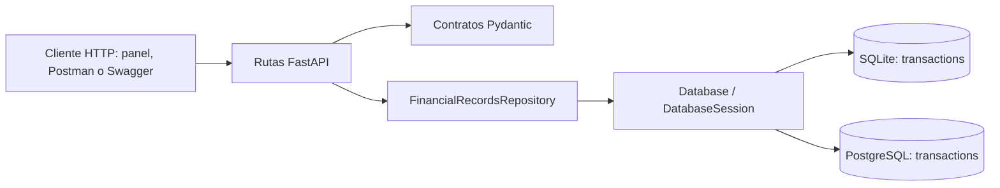

Repository concentra el SQL fuera de los endpoints: estos delegan en
`create_transaction`, `list_transactions` y `monthly_summary`. La restricción
única por usuario/clave y el hash del cuerpo permiten reconocer repeticiones y
conflictos. `Decimal` permite sumar importes. La dependencia es sobre la clase
concreta; no existe una interfaz abstracta ni una capa independiente de casos de uso.

Microservicios adicionales, Facade entre subsistemas, Observer, Gateway y
Database per Service para múltiples dominios forman parte del diseño objetivo,
sin implementación adicional en esta entrega.

### 5.1.3. Pattern Based Custom Software Library

El PDF propone `finanzen_common`, una librería pequeña de capacidades
transversales. No hay un paquete de ese nombre en el código incorporado.

| Módulo propuesto | Responsabilidad |
| --- | --- |
| `errors` | Modelo común de errores |
| `observability` | Correlation ID y logging estructurado |
| `security` | Identidad propagada y validaciones comunes |
| `events` | Envelope, identificadores y metadatos |
| `idempotency` | Utilidades para claves idempotentes |
| `testing` | Fixtures y factories |

No debe concentrar reglas o entidades de todos los dominios. Su versionado
semántico y distribución deberán definirse cuando se implemente.

### 5.1.4. Framework Pattern Driven Refactoring Report

| Aspecto | Propuesta del PDF | Estado de esta organización |
| --- | --- | --- |
| Controladores | Delegar en casos de uso y mantener routers delgados | Endpoints siguen en `app/main.py`; refactorización pendiente |
| Persistencia | Interfaces de repositorio y adaptador SQLite | Adaptador `Database` para SQLite/PostgreSQL; sin interfaz abstracta de repositorio |
| Errores | Excepciones de aplicación y contrato uniforme | Handler de conflicto idempotente existente; normalización completa pendiente |
| Configuración | Variables de entorno y eliminación de rutas dependientes de máquina | `DATABASE_URL`, `FINANZEN_DB_PATH` y `FINANZEN_FRONTEND_PATH`; validación al arrancar en Render |
| Observabilidad | Correlation ID y logs estructurados | Pendiente |
| Eventos | Publicación para alertas, análisis y auditoría | Pendiente |

La organización adapta la ruta del frontend y conserva la API independiente.
La descripción OpenAPI se corrigió para no afirmar que US10–US12 estén completas.
Se extrajo el acceso a conexiones/transacciones a `app/database.py` y se añadió
PostgreSQL conservando SQLite local. La refactorización completa de casos de
uso, errores, observabilidad y eventos sigue pendiente.

El código actual selecciona el frontend mediante `FINANZEN_FRONTEND_PATH` o
la carpeta vecina `front`, y solo monta archivos estáticos si la ruta existe.
Las pruebas `test_frontend_is_served` y `test_backend_runs_without_frontend`
respaldan la ruta personalizada y la ejecución de la API sin cliente web.

Comparación verificable:
[antes/después del adaptador](https://github.com/1ASI0657-2620-9199/back/compare/8acb9b29b3086010ac4e13fad26519ced425024f...f218113d0e8cc4f2f431d4573eac40e47cbb0ee3).
Antes, el repositorio abría conexiones SQLite directamente; después delega en
`Database`, que adapta parámetros/resultados y asegura commit, rollback y cierre.
En PostgreSQL se serializa la creación por usuario/clave con
`pg_advisory_xact_lock`, preservando la respuesta 201/200/409 del contrato.
Las ocho pruebas y la ejecución de Newman verifican el comportamiento conservado.

## 5.2. Software Configuration Management

### 5.2.1. Software Development Environment Configuration

| Elemento | Versión / uso | Estado |
| --- | --- | --- |
| Python | 3.10 o superior; validación local con 3.11 | Disponible para el backend |
| FastAPI | 0.122.0 | Implementado |
| Pydantic | 2.12.5 | Implementado |
| Uvicorn | 0.38.0 | Servidor local |
| SQLite | Módulo estándar de Python | Persistencia local |
| PostgreSQL / pg8000 | PostgreSQL 17 / pg8000 1.31.5 | Integración local y deployment Neon Free verificados |
| pytest / httpx | 8.3.5 / 0.28.1 | Pruebas automatizadas |
| HTML, CSS, JavaScript | Panel sin compilación | Implementado |
| Postman / Newman | Colección del Sprint 1 ejecutada con Newman | 8 peticiones, 11 aserciones; capturas originales de Postman Desktop históricas |
| Apache Kafka | Mensajería propuesta | Pendiente |
| Angular / Flutter / C# | Tecnologías del diagrama original | Sin proyecto Angular, Flutter o C# incorporado |

Dependencias fijadas en [requirements.txt](https://github.com/1ASI0657-2620-9199/back/blob/main/requirements.txt).
Los pasos de instalación están en [back](https://github.com/1ASI0657-2620-9199/back/blob/main/README.md) y
[front](https://github.com/1ASI0657-2620-9199/front/blob/main/README.md).

Preparación del entorno Windows desde `back`:

```powershell
python -m venv .venv
.\.venv\Scripts\python.exe -m pip install -r requirements.txt
.\.venv\Scripts\python.exe -m pytest -q -p no:cacheprovider
.\.venv\Scripts\python.exe -m uvicorn app.main:app --host 127.0.0.1 --port 8000
```

Se utilizan Git/GitHub para versionar código, pytest/TestClient para pruebas,
Swagger/OpenAPI para documentar la API y Newman para ejecutar la colección de
Postman. Node.js, Playwright y Chrome se usan solo para capturar evidencias.
La elección del gestor de tareas y las referencias de acceso/descarga de las
herramientas utilizadas por el equipo deben completar este apartado.

### 5.2.2. Source Code Management

La ubicación común es la [organización FinanZen](https://github.com/orgs/1ASI0657-2620-9199/repositories).
Los cinco repositorios independientes son `back`, `report`, `landing`, `front`
y `mobile`. Cada uno tiene su historial, README, remoto y configuración.

Se conserva el historial existente de `report`. Los repositorios iniciales
`FinanSmart-Back`, `FinanSmart-Platform` y `Landing-Page` se reutilizaron como
`back`, `front` y `landing`; `mobile` se creó para reservar su desarrollo.
El repositorio personal anterior conserva la organización inicial como antecedente.

El PDF menciona un repositorio `platform`, ramas `main` y `develop` y el commit
histórico `41ff14d` atribuido a Renzo Revilla. Esa información se conserva como
evidencia del documento, no como un commit importado a este historial.

La estrategia académica propuesta es GitFlow (`main`, `develop`, `feature/*`,
`release/*`, `hotfix/*`), Conventional Commits y SemVer. No se presentan ramas
propuestas como ramas ya creadas. La versión de API existente es `0.1.0`; eso
no constituye una etiqueta de release publicada.

Al revisar el remoto de `back` el 10 de octubre de 2026 se encuentra la rama
`main`, sin etiquetas publicadas. Las convenciones propuestas son
`feature/<id>-<descripcion>`, `release/<version>` y `hotfix/<descripcion>`, con
nombres en inglés y versiones `MAJOR.MINOR.PATCH`. Se debe evidenciar su uso
real cuando el equipo las adopte. Los commits de 5.3.1.2 incorporan los proyectos;
no prueban la autoría histórica de cada tarea del PDF.

### 5.2.3. Source Code Style Guide & Conventions

Se conservan los nombres del código. El PDF propone PEP 8, PEP 257,
`snake_case` para funciones/módulos, `PascalCase` para clases,
`UPPER_SNAKE_CASE` para constantes, endpoints de recursos en plural y type hints.
También propone errores sin secretos y pruebas de comportamiento.

El [workflow del backend](https://github.com/1ASI0657-2620-9199/back/blob/main/.github/workflows/validacion.yml)
instala dependencias y ejecuta su suite. El frontend valida su JavaScript y
la integración con una copia del backend. El reporte comprueba sus enlaces
internos y la integridad del PDF fuente mediante su propio workflow.
No se afirma haber ejecutado linter, formatter o verificación de tipos.

| Convención | Ejemplo verificable del backend |
| --- | --- |
| Nombres en inglés y `snake_case` | `create_transaction`, `monthly_summary`, `database_path` |
| Clases en `PascalCase` | `TransactionCreate`, `MonthlySummary`, `FinancialRecordsRepository` |
| Constantes en mayúsculas | `MONTH_PATTERN`; valores `INCOME` y `EXPENSE` del enum |
| Anotaciones de tipos | `list[TransactionResponse]`, `Decimal`, `str \| None` |
| Recursos REST en plural | `/api/v1/transactions` |
| Pruebas nombradas por comportamiento | `test_create_is_idempotent_and_rejects_key_reuse` |

Las convenciones del frontend y de Gherkin deben completarse por separado.
Estos ejemplos no constituyen una auditoría automática de estilo.

### 5.2.4. Software Deployment Configuration

El apartado aparece vacío en el PDF. En esta entrega se documenta una ejecución
local reproducible, sin inventar un despliegue remoto:

```powershell
cd back
python -m pip install -r requirements.txt
python -m uvicorn app.main:app --host 127.0.0.1 --port 8000
```

Panel en `http://127.0.0.1:8000`, Swagger en `/docs`, OpenAPI en `/openapi.json`
y estado en `/health`. La carpeta `data` y la tabla se inicializan al arrancar.
SQLite, cachés, secretos y entornos virtuales no se versionan.

Vista del despliegue local con los elementos de una vista C4 de despliegue:

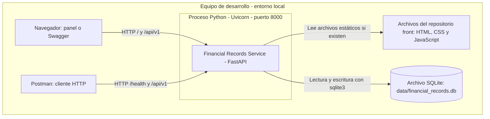

El panel es opcional y se sirve desde el mismo proceso que expone la API.
`FINANZEN_DB_PATH` cambia el archivo de persistencia y
`FINANZEN_FRONTEND_PATH` cambia la ubicación del panel. La guía del Sprint 1
indica cómo usar una base separada para las capturas. Este diagrama representa
ejecución local, no infraestructura cloud.

Se añadió el [Blueprint Render Free](https://github.com/1ASI0657-2620-9199/back/blob/main/render.yaml),
validado contra el schema oficial, y la
[guía de deployment](https://github.com/1ASI0657-2620-9199/back/blob/main/DEPLOYMENT.md).
La API está publicada en Render Free y los datos en Neon Free PostgreSQL,
con `DATABASE_URL` privada y conexión TLS. No se requiere disco de pago.
El arranque en Render falla si falta PostgreSQL, evitando escribir datos en SQLite efímero.
`DATABASE_URL` selecciona PostgreSQL; `FINANZEN_DB_PATH` conserva el modo SQLite local.
El comando cloud escucha en `0.0.0.0:$PORT` y utiliza `/health` como health check.

La [vista de arquitectura y evidencias](../evidencias/deployment/README.md)
identifica los recursos creados y su validación pública el 10 de octubre de 2026:

| Elemento cloud | Configuración verificada |
| --- | --- |
| URL API | https://finanzen-financial-records.onrender.com |
| Render Web Service | `srv-db4vl25ckfvc738e4hp0`, plan **Free**, Virginia, Python 3.11.9 |
| Neon PostgreSQL | Proyecto `dawn-bird-07958545`, PostgreSQL 17, organización **Free**, `aws-us-east-1` |
| Conexión | `DATABASE_URL` privada, pooling PostgreSQL y TLS verificado |
| Datos | En Neon; sin disco de pago en Render |
| Health y contrato | `/health`, `/docs`, `/openapi.json`: HTTP 200 |

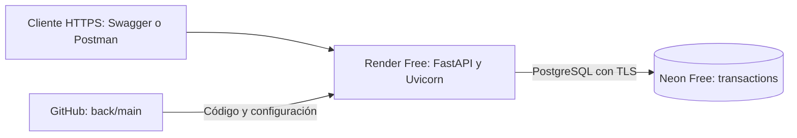

Los [registros del servicio](../evidencias/deployment/publico/render-service.json)
y [recursos Neon](../evidencias/deployment/publico/neon-resources.json) documentan
esta configuración sin revelar credenciales. CON-05 conserva la restricción
original del PDF; la decisión aplicada en esta entrega usa Render y Neon.

## 5.3. MicroServices Implementation

### 5.3.1. Sprint 1

#### 5.3.1.1. Sprint Backlog 1

Objetivo registrado en la fuente: permitir crear ingresos/egresos, consultar
movimientos por usuario y obtener un resumen mensual con API documentada y
pruebas. La siguiente tabla conserva estimaciones y responsables del PDF;
no atribuye la organización posterior a esos integrantes.

| ID | Trabajo del PDF | Estimación | Responsable registrado | Estado del PDF |
| --- | --- | --- | --- | --- |
| US01 | Registrar datos financieros | 8 SP | Rodrigo Oblitas | Done |
| TASK-01 | Crear Financial Records Service | 3 h | Renzo Revilla | Done |
| TASK-02 | Modelo de transacción | 2 h | Joan Aguirre | Done |
| TASK-03 | Registrar transacción | 3 h | Renzo Revilla | Done |
| TASK-04 | Consultar transacciones | 2 h | Rodrigo Oblitas | Done |
| TASK-05 | Resumen mensual | 3 h | Joan Aguirre | Done |
| TASK-06 | Idempotencia | 2 h | Renzo Revilla | Done |
| TASK-07 | Aislamiento mediante X-User-Id | 2 h | Rodrigo Oblitas | Done |
| TASK-08 | Persistencia SQLite | 2 h | Joan Aguirre | Done |
| TASK-09 | OpenAPI/Swagger | 1 h | Renzo Revilla | Done |
| TASK-10 | Testing Suite | 3 h | Joan Aguirre | Done |
| TASK-11 | Frontend funcional | 3 h | Rodrigo Oblitas | Done |

La marca Done de US01 corresponde al recorte del sprint en el PDF. Sus
criterios de cuentas/saldos y su equivalencia con el registro de movimientos
requieren revisión; se documentan como cobertura parcial en el capítulo III.

Trazabilidad comprobable del incremento:

| Trabajo del backlog fuente | Código y comportamiento actual | Alcance |
| --- | --- | --- |
| TASK-02/03/06/08 | Modelo, POST, idempotencia y tabla SQLite/PostgreSQL | Registro de movimientos; PostgreSQL añadido en esta actualización |
| TASK-04/07 | GET de movimientos filtrado por `X-User-Id` | Separación lógica por identidad suministrada; no login |
| TASK-05 | GET de resumen por mes y moneda | Ingresos, gastos, saldo y cantidad de movimientos |
| TASK-09/10 | OpenAPI y ocho pruebas pytest | Contrato y pruebas disponibles; BDD pendiente |
| TASK-11 | Panel del repositorio `front` conectado a la API | Cliente web existente |

Faltan captura y URL pública del board y la tabla con descomposición US → tarea,
descripción, horas, responsable y estado, validada por el equipo. La tabla
histórica no reemplaza un tablero actual ni acredita cuentas/saldos iniciales de US01.

#### 5.3.1.2. Development Evidence for Sprint Review

La evidencia original describe once archivos del servicio inicial y el commit
`41ff14d` de `platform`. Se conserva su captura:


La evidencia actual está en [back/app](https://github.com/1ASI0657-2620-9199/back/tree/main/app),
[back/tests](https://github.com/1ASI0657-2620-9199/back/tree/main/tests) y [front](https://github.com/1ASI0657-2620-9199/front/tree/main/). El README del repositorio
ya dirige al informe y a cada componente, en lugar de contener todo el reporte.

Commits reales de incorporación a los repositorios independientes; fechas en
America/Lima (`UTC-05:00`):

| Repository | Branch de integración | Commit Id | Commit Message | Commit Message Body | Committed on (Date) |
| --- | --- | --- | --- | --- | --- |
| `1ASI0657-2620-9199/back` | `main` | [6ff8141](https://github.com/1ASI0657-2620-9199/back/commit/6ff8141000371271d8b91ebc8d0b7ed5fdea1906) | `feat: initialize independent FinanZen back project` | Sin cuerpo | 2026-10-10 02:39:35 -05:00 |
| `1ASI0657-2620-9199/front` | `main` | [e0b1ac5](https://github.com/1ASI0657-2620-9199/front/commit/e0b1ac5b272004863300c2a8a4eb2c5222a58111) | `feat: initialize independent FinanZen front project` | Sin cuerpo | 2026-10-10 02:39:53 -05:00 |
| `1ASI0657-2620-9199/back` | `main` | [f218113](https://github.com/1ASI0657-2620-9199/back/commit/f218113d0e8cc4f2f431d4573eac40e47cbb0ee3) | `feat: support PostgreSQL for free persistent cloud deployment` | Sin cuerpo | 2026-10-10 03:14:03 -05:00 |

El commit de back incluye rutas, contratos, persistencia, tests y workflow;
el de front incluye el panel y su comprobación de integración. No hay un commit
por cada TASK ni se atribuye esta incorporación al sprint histórico del PDF.
El equipo debe añadir futuros avances reales con la misma estructura.

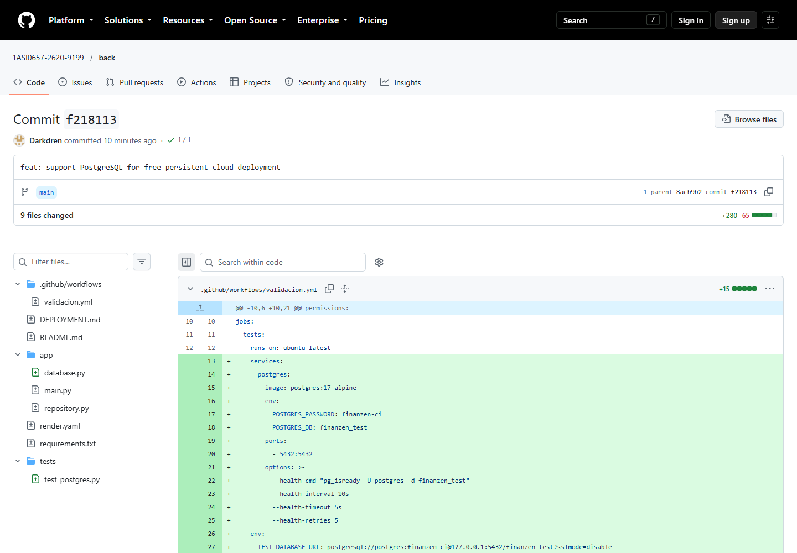

#### 5.3.1.3. Testing Suite Evidence for Sprint Review

El PDF registra tres comportamientos con resultado Passed. La suite incorporada
contiene ocho pruebas y se ejecuta nuevamente con PostgreSQL real. Los resultados
actuales se detallan en [evidencias/validacion.md](../evidencias/validacion.md).

| Repository | Branch | Commit Id | Commit Message | Commit Message Body | Committed on (Date) | Evidencia de testing |
| --- | --- | --- | --- | --- | --- | --- |
| `1ASI0657-2620-9199/back` | `main` | [6ff8141](https://github.com/1ASI0657-2620-9199/back/commit/6ff8141000371271d8b91ebc8d0b7ed5fdea1906) | `feat: initialize independent FinanZen back project` | Sin cuerpo | 2026-10-10 02:39:35 -05:00 | Incorpora `tests/test_api.py` y el workflow de pytest |
| `1ASI0657-2620-9199/back` | `main` | [f218113](https://github.com/1ASI0657-2620-9199/back/commit/f218113d0e8cc4f2f431d4573eac40e47cbb0ee3) | `feat: support PostgreSQL for free persistent cloud deployment` | Sin cuerpo | 2026-10-10 03:14:03 -05:00 | Añade tres pruebas PostgreSQL y servicio PostgreSQL en CI |

La [salida actual](../evidencias/deployment/local/pytest.txt) contiene ocho pruebas
aprobadas; se incorpora una [vista del registro real](../evidencias/deployment/local/02-pytest.png).
La suite respalda el recorte de registro de movimientos de US01 y el
resumen mensual de PF-02; no valida todos los criterios de US01 ni presupuestos/alertas.

El [workflow verificado](https://github.com/1ASI0657-2620-9199/back/actions/runs/38037169861)
terminó con estado **Success** sobre `f218113`. Su
[registro de estado](../evidencias/deployment/local/github-actions.json)
identifica el run y el commit; la imagen siguiente muestra la página real de GitHub.

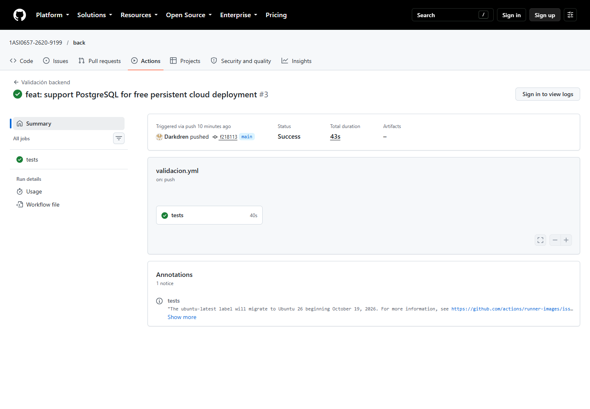

El statement solicita archivos `.feature`, escenarios Gherkin, relación con
historias y commits. El backend utiliza pytest/TestClient y no contiene
`.feature`; esta parte queda pendiente de implementación y ejecución.

#### 5.3.1.4. Execution Evidence for Sprint Review

Las capturas de Postman del PDF muestran pruebas históricas del servicio local:


| Método | Ruta | Uso |
| --- | --- | --- |
| GET | `/health` | Estado operativo |
| POST | `/api/v1/transactions` | Registrar movimiento |
| GET | `/api/v1/transactions` | Consultar movimientos |
| GET | `/api/v1/summary` | Resumen mensual por moneda y usuario |

La comprobación de esta entrega utiliza TestClient y registra por separado sus
resultados; las capturas originales no se presentan como nuevas ejecuciones.

Se adjuntan [ocho respuestas reales de la API](../evidencias/sprint-1/respuestas-api.json)
obtenidas con TestClient y SQLite temporal. Incluyen cuerpo y cabeceras de
solicitud, estado HTTP y cuerpo de respuesta:

| Operación | Resultado observado |
| --- | --- |
| Health | HTTP 200; servicio `financial-records-service` en estado `ok` |
| Crear ingreso de PEN 1000.00 | HTTP 201; ID del movimiento generado |
| Repetir ingreso con la misma clave y cuerpo | HTTP 200; mismo ID; `Idempotent-Replayed: true` |
| Reutilizar clave con otro importe | HTTP 409; conflicto idempotente |
| Crear gasto de PEN 125.50 | HTTP 201 |
| Consultar movimientos | HTTP 200; dos movimientos del usuario de muestra |
| Resumen de octubre de 2026 | HTTP 200; ingresos 1000.00, gastos 125.50, saldo 874.50 |
| Consultar mes `2026-13` | HTTP 422; mes inválido |

La [colección de Postman](../evidencias/sprint-1/FinanZen-Sprint1.postman_collection.json)
se ejecutó contra Uvicorn/PostgreSQL local con Newman: **8 peticiones, 11
aserciones y 0 fallos**. Consultar el [log real](../evidencias/deployment/local/newman.txt),
el [reporte JSON](../evidencias/deployment/local/newman.json) y las
[trece capturas explicadas](../evidencias/deployment/README.md).
Las vistas de registros identifican a Newman como runner; no son capturas de
Postman Desktop. La [grabación real](../evidencias/deployment/local/demostracion.webm)
muestra Swagger y registros locales, sin narración. El enlace publicado y la
explicación oral del equipo quedan pendientes si la entrega los requiere.

Evidencias de ejecución ubicadas en este apartado; todas corresponden al
servidor local Uvicorn con PostgreSQL del 10 de octubre de 2026:

| Evidencia | Resultado demostrado |
| --- | --- |
| [Ejecución Newman](../evidencias/deployment/local/01-newman.png) | Ocho peticiones y once aserciones sin fallos |
| [Health en Swagger](../evidencias/deployment/local/04-health.png) | HTTP 200, servicio operativo |
| [Crear ingreso](../evidencias/deployment/local/05-create-income.png) | HTTP 201 para PEN 1000.00 |
| [Repetición idempotente](../evidencias/deployment/local/08-replay.png) | HTTP 200 y mismo ID |
| [Conflicto idempotente](../evidencias/deployment/local/09-conflict.png) | HTTP 409 por otro importe con la misma clave |
| [Listado](../evidencias/deployment/local/06-list.png) | Dos movimientos del usuario de muestra |
| [Resumen mensual](../evidencias/deployment/local/07-summary.png) | Ingreso 1000.00, gasto 125.50 y saldo 874.50 |
| [Registro HTTP](../evidencias/deployment/local/swagger-http.json) | Operaciones y respuestas observadas en Swagger |
| [Grabación](../evidencias/deployment/local/demostracion.webm) | Interacciones reales con Swagger y vistas de los registros, sin narración |

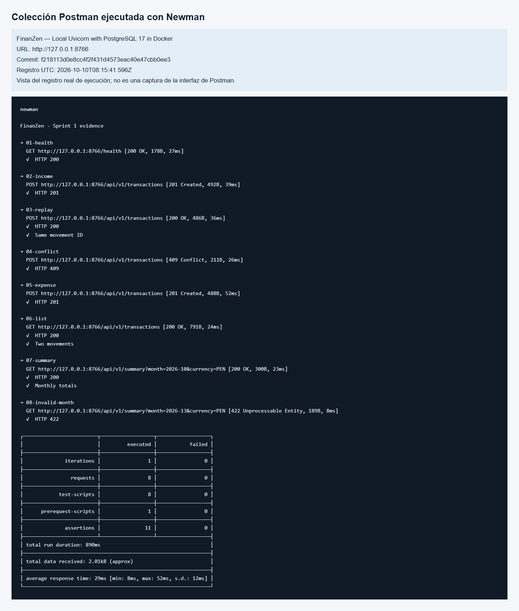

**Validación adicional en nube:** la misma colección se ejecutó contra
`https://finanzen-financial-records.onrender.com`: **8 peticiones, 11 aserciones,
0 fallos**. Se adjuntan [log público](../evidencias/deployment/publico/newman.txt),
[reporte JSON](../evidencias/deployment/publico/newman.json),
[respuestas Swagger públicas](../evidencias/deployment/publico/swagger-http.json)
y [grabación del servicio público](../evidencias/deployment/publico/demostracion.webm).
Los POST demostraron 201/200/409 y el resumen devolvió saldo PEN 874.50.
La grabación muestra interacción real, sin narración.

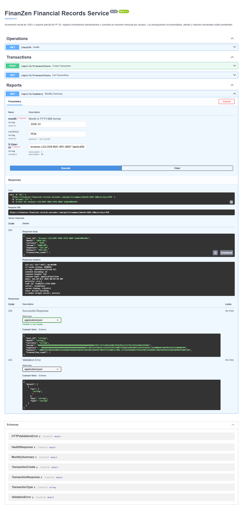

#### 5.3.1.5. Microservices Documentation Evidence for Sprint Review

FastAPI genera Swagger y OpenAPI a partir de la aplicación. Se conserva un
[contrato OpenAPI de esta entrega](../evidencias/openapi.json), además de la
guía del backend. El contrato describe el servicio disponible, sin endpoints
inventados para capacidades futuras.

Base local: `http://127.0.0.1:8000`. [Swagger local](http://127.0.0.1:8000/docs)
y [OpenAPI local](http://127.0.0.1:8000/openapi.json) requieren el servidor iniciado.

Servicio publicado: [Swagger público](https://finanzen-financial-records.onrender.com/docs)
y [OpenAPI público](https://finanzen-financial-records.onrender.com/openapi.json).
Se conserva el [contrato descargado del servidor cloud](../evidencias/deployment/publico/openapi.json).

| Acción | Llamada y parámetros | Respuesta |
| --- | --- | --- |
| Estado | `GET /health`; sin cabeceras financieras | 200: `status` y `service` |
| Registrar movimiento | `POST /api/v1/transactions`; `X-User-Id`, `Idempotency-Key` y cuerpo JSON | 201 nuevo, 200 repetido, 409 conflicto, 422 datos inválidos |
| Consultar movimientos | `GET /api/v1/transactions`; `X-User-Id`; sin query params | 200: arreglo de movimientos; 422 si falta la cabecera |
| Resumen mensual | `GET /api/v1/summary?month=2026-10&currency=PEN`; `X-User-Id`; mes obligatorio, moneda opcional (PEN) | 200: ingresos, gastos, saldo y cantidad; 422 para entradas inválidas o requeridas ausentes |

`X-User-Id` admite de 1 a 80 caracteres. `Idempotency-Key` admite de 8 a 120
caracteres y es obligatorio en el POST. El cuerpo requiere `account_id`, `type`
(`income` o `expense`), `amount` positivo con hasta dos decimales y `category`.
`currency` es opcional (PEN, tres letras mayúsculas), `occurred_at` es opcional
(fecha/hora actual UTC) y `description` es opcional (hasta 240 caracteres).
Se fija `occurred_at` en los ejemplos para que el cuerpo sea idéntico al repetirlo.

Ejemplo de registro incluido en la colección:

```json
{
  "account_id": "cash-account",
  "type": "income",
  "amount": "1000.00",
  "currency": "PEN",
  "category": "salary",
  "occurred_at": "2026-10-01T10:00:00Z",
  "description": "Ingreso de demostración Sprint 1"
}
```

La respuesta agrega `id`, `user_id` y `created_at`. Los valores generados se
conservan en el JSON capturado. Resumen observado después del ingreso y gasto:

```json
{
  "user_id": "sprint1-evidence-user",
  "month": "2026-10",
  "currency": "PEN",
  "income": "1000.00",
  "expenses": "125.50",
  "balance": "874.50",
  "transaction_count": 2
}
```

El saldo es ingresos menos gastos y el conteo corresponde al mes y moneda
consultados. Los importes se serializan como cadenas decimales.

| Repository | Commit de documentación | Artefacto |
| --- | --- | --- |
| [back](https://github.com/1ASI0657-2620-9199/back) | [6ff8141](https://github.com/1ASI0657-2620-9199/back/commit/6ff8141000371271d8b91ebc8d0b7ed5fdea1906) | Metadatos/contratos FastAPI y README de Swagger/OpenAPI |
| [report](https://github.com/1ASI0657-2620-9199/report) | [5176faa](https://github.com/1ASI0657-2620-9199/report/commit/5176faa24f59e8506e6eedb564bdd7b208d3cfeb) | `evidencias/openapi.json` y guía del servicio |

Se incorporan capturas reales de Swagger local con peticiones, parámetros y
respuestas: [contrato](../evidencias/deployment/local/03-swagger-endpoints.png),
[POST con HTTP 201](../evidencias/deployment/local/05-create-income.png) y
[resumen con HTTP 200](../evidencias/deployment/local/07-summary.png).
El [índice completo](../evidencias/deployment/README.md) explica cada captura y su apartado.

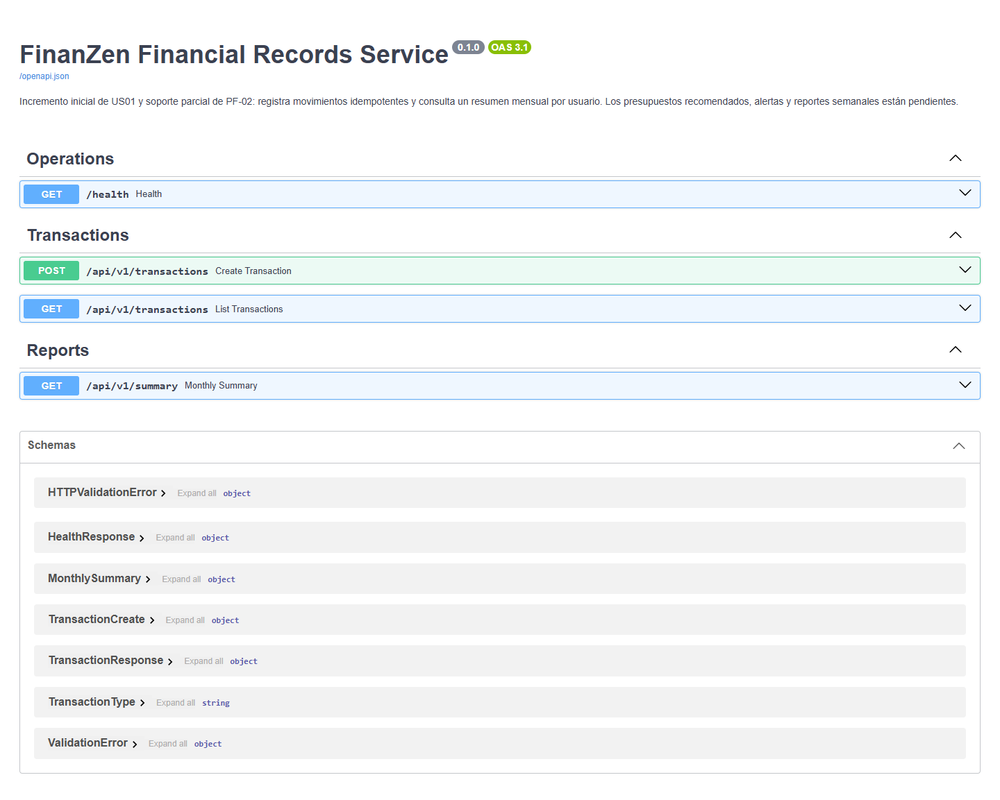


#### 5.3.1.6. Software Deployment Evidence for Sprint Review

**Despliegue realizado:** Render Free + Neon Free, verificado el 10 de octubre
de 2026. URL real: https://finanzen-financial-records.onrender.com.

| Actividad realizada | Resultado y evidencia |
| --- | --- |
| Crear PostgreSQL | Neon Free, PostgreSQL 17, región US East 1; [recursos verificados](../evidencias/deployment/publico/neon-resources.json) |
| Crear servicio API | Render Free desde `back/main`, Python/Uvicorn y variable privada; [configuración](../evidencias/deployment/publico/render-service.json) |
| Instalar y construir | Build successful; [log original](../evidencias/deployment/publico/render-build-logs.json) y [vista](../evidencias/deployment/publico/14-render-build.png) |
| Publicar | Deploy `dep-db4vl2tckfvc738e4j60`, commit `525ac3f`, estado `live`; [registro](../evidencias/deployment/publico/render-deploys.json) |
| Validar acceso público | Health, Swagger y OpenAPI HTTP 200; [resultado](../evidencias/deployment/publico/public-endpoints.json) |
| Validar operaciones | Newman: 8 peticiones, 11 aserciones, 0 fallos; [reporte](../evidencias/deployment/publico/newman.json) |
| Reiniciar Render | Solicitud aceptada y nuevo arranque en logs; [solicitud](../evidencias/deployment/publico/reinicio-solicitud.json), [log original](../evidencias/deployment/publico/render-runtime-logs.json) y [vista](../evidencias/deployment/publico/15-render-runtime.png) |
| Comprobar persistencia | Dos IDs conservados, saldo PEN 92.66 y replay HTTP 200 sin duplicados; [resultado antes/después](../evidencias/deployment/publico/persistencia.json) |

La prueba de persistencia creó datos sintéticos con un usuario independiente:
ingreso 105.00 y gasto 12.34. El nuevo arranque quedó registrado a las 03:46:03
America/Lima. Por eso su saldo difiere del saldo 874.50 de la demostración Swagger.
La configuración mantiene la conexión PostgreSQL privada y no utiliza disco de pago.

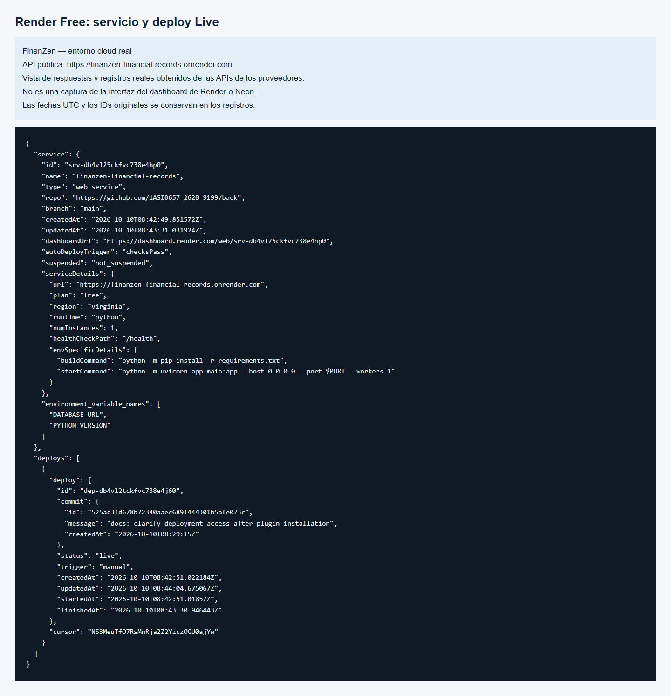

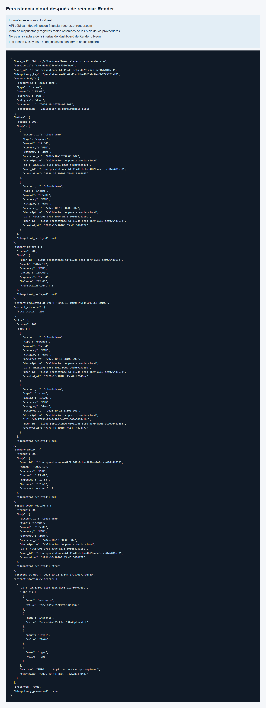

El [índice cloud completo](../evidencias/deployment/publico/README.md) reúne
13 capturas públicas, grabación y registros originales. Las vistas de logs/API
están identificadas; las capturas de Swagger muestran el servicio HTTPS real.

**Antecedente local:** se conserva la verificación previa realizada antes de publicar.

Se preparó la configuración gratuita Render/Neon y se ejecutó Uvicorn con
PostgreSQL 17 local. Se incorporan el
[registro de arranque y peticiones](../evidencias/deployment/local/11-server-log.png),
la [comprobación de persistencia](../evidencias/deployment/local/persistencia.json)
y su [vista antes/después](../evidencias/deployment/local/10-persistence.png).
La comprobación detuvo y reinició realmente el proceso Uvicorn: los dos IDs
permanecieron iguales. Esta prueba acredita persistencia PostgreSQL local.

El [registro del entorno](../evidencias/deployment/local/metadata.json) identifica
la URL local, fecha y commit utilizado. El
[log original de Uvicorn](../evidencias/deployment/local/uvicorn.txt) complementa
la captura del arranque.

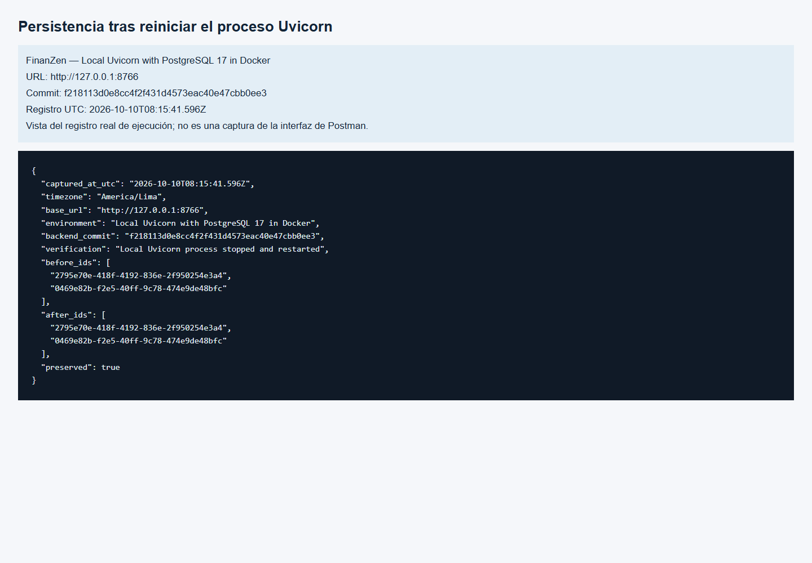

El [índice de deployment](../evidencias/deployment/README.md) distingue evidencias
locales y públicas. La publicación, los logs y la persistencia remota ya están
verificados; las capturas locales anteriores conservan su identificación de entorno.

El índice del statement ubica el despliegue cloud completo en TF1 y permite
URL local para documentar sprints previos al despliegue de Web Services.
El proveedor aplicado por decisión del usuario es Render/Neon. CON-05 del PDF
menciona AWS, Azure o Google Cloud; se conserva como restricción académica original.
No se presenta el servicio Render como un deployment directo en esos proveedores.

#### 5.3.1.7. Team Collaboration Insights during Sprint

El PDF contiene el título sin desarrollo. Se conserva el backlog y sus
responsables, sin inventar reuniones, revisiones ni conclusiones de colaboración.

#### 5.3.1.8. Kanban Board

El PDF contiene el título sin enlace o tablero verificable. Queda pendiente
incorporar una evidencia real de Kanban.

La [guía de evidencias](../evidencias/sprint-1/README.md) especifica las capturas,
enlaces y datos del equipo que faltan para completar los apartados del Sprint 1.

## Cambios y pendientes de esta entrega

- Cinco repositorios independientes en una organización, con documentación y estados explícitos.
- Backend y frontend incorporados desde los proyectos organizados previamente.
- Ruta automática actualizada a `front/`, conservando API sin cliente web.
- PDF, transcripción de las 109 páginas, figuras y README histórico conservados.
- Informe ampliado con entrevistas, 14 historias, drivers y cinco iteraciones ADD.
- Pruebas, contrato OpenAPI, script de comprobación y empaquetado reproducible.
- Adaptador SQLite/PostgreSQL, ocho pruebas aprobadas y configuración Render Free/Neon Free publicada.
- Once capturas reales, colección ejecutada con Newman y grabación local de Swagger.
- Capturas reales de GitHub Actions aprobado y del commit de PostgreSQL; trece imágenes en total.
- API publicada en Render Free con Neon Free, trece capturas públicas adicionales, grabación y persistencia remota verificada.
- Repositorios landing y mobile preparados sin código, según confirmación del usuario.

Siguen pendientes autenticación, cuentas/saldos, presupuestos, alertas,
eventos, IoT, proyecciones, educación y auditoría.
