# Capítulo V: Product Implementation, Validation & Deployment

[Volver al informe](../README.md). Fuente académica conservada; evidencias históricas del Sprint 1 verificadas el 10 de octubre de 2026 y apartados 5.3.3.2, 5.3.3.4 y 5.3.3.6 actualizados el 26 de noviembre de 2026.

**Lectura por entrega:** los apartados 5.1, 5.2 y 5.3.1 describen el estado histórico del Sprint 1. Sus pendientes técnicos corresponden a esa fecha. Las evidencias nuevas de Docker, Kafka y los servicios de Sprint 3 se presentan en 5.3.3; allí se documenta la ejecución local integrada del 26 de noviembre.

## 5.1. Testing Suites & General Patterns

El Financial Records Service combina FastAPI/Pydantic, Repository, adaptación de persistencia SQLite/PostgreSQL y una biblioteca propia con Strategy. La entrega verifica el recorte de registro de movimientos de US01 y el resumen mensual de PF-02; presupuestos, autenticación, eventos y alertas no están implementados.

Estado verificado el **10 de octubre de 2026**, America/Lima. API publicada **0.1.1**; biblioteca **0.1.0**.

### 5.1.1. Backend Application Core Testing Suite

Se ejecutaron **12 casos pytest aprobados**: cinco SQLite, tres PostgreSQL 17 real y cuatro de la biblioteca. La ejecución local obtuvo **12 passed in 1.71s**. [CI de main](https://github.com/1ASI0657-2620-9199/back/actions/runs/38041971339) aprobó la suite, BDD y build del paquete.

| Grupo | Casos | Validación |
| --- | --- | --- |
| SQLite / TestClient | 5 | Registro 201, replay 200, conflicto 409; resumen/aislamiento; frontend configurable; API sin frontend; persistencia al recrear app |
| PostgreSQL 17 | 3 | Operaciones/aislamiento; persistencia; ocho solicitudes concurrentes crean solo un movimiento |
| finanzen-common | 4 | Compatibilidad con huellas históricas Unicode; orden de claves; cambio de contenido sin mutar entrada; estrategia inyectable |

Código: [test_api.py](https://github.com/1ASI0657-2620-9199/back/blob/v0.1.1/tests/test_api.py), [test_postgres.py](https://github.com/1ASI0657-2620-9199/back/blob/v0.1.1/tests/test_postgres.py), [test_common.py](https://github.com/1ASI0657-2620-9199/back/blob/v0.1.1/tests/test_common.py). Para reproducir desde back: instalar requirements-dev.txt y ejecutar `python -m pytest -q -p no:cacheprovider`. `TEST_DATABASE_URL` debe señalar una base exclusiva de validación; sin ella se omiten tres casos PostgreSQL.

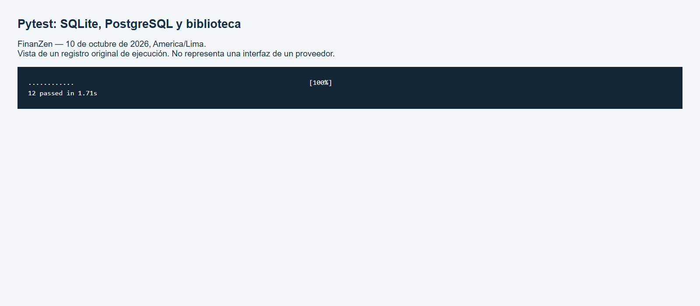

[Registro original](../evidencias/cierre-sprint-1/pytest.txt). `X-User-Id` acredita separación lógica de datos de demostración, no login ni autorización real.

### 5.1.2. Pattern Based Backend Application(s)

| Patrón / elemento | Implementación | Responsabilidad |
| --- | --- | --- |
| Repository | FinancialRecordsRepository | Esquema, inserción, consultas y resumen mensual |
| Adaptación de persistencia | Database / DatabaseSession | Conexiones SQLite/PostgreSQL, parámetros ligados, resultados, commit/rollback/cierre |
| Strategy | FingerprintStrategy / CanonicalJsonSha256 / FingerprintService | Huella determinista reemplazable usada para idempotencia |
| Contratos HTTP | FastAPI / Pydantic | Validación de entradas y generación de OpenAPI |

Flujo actual: cliente HTTPS → rutas FastAPI → Repository → Database → PostgreSQL; el repositorio utiliza FingerprintService para la huella del payload. El bloqueo transaccional PostgreSQL mantiene un único movimiento por usuario/clave ante concurrencia.

Evidencias: [código publicado](https://github.com/1ASI0657-2620-9199/back/tree/v0.1.1/app), [biblioteca](https://github.com/1ASI0657-2620-9199/back/tree/v0.1.1/libraries/finanzen_common) y doce pruebas. Facade, Observer, gateway y Kafka permanecen como propuestas del diseño original, sin componentes desplegados.

### 5.1.3. Pattern Based Custom Software Library

**Implementado:** `finanzen-common` 0.1.0 es una distribución Python independiente de FastAPI y de las bases de datos, almacenada en `libraries/finanzen_common`. Se empaqueta con pyproject.toml y layout src, se instala desde requirements.txt y el backend la consume en `FinancialRecordsRepository._request_hash`.

| Elemento | Función |
| --- | --- |
| FingerprintStrategy (Protocol) | Contrato de estrategia para un payload JSON |
| CanonicalJsonSha256 | JSON ordenado, separadores compactos y SHA-256 compatibles con el backend previo |
| FingerprintService | Delega en una estrategia inyectada; utiliza CanonicalJsonSha256 por defecto |

El paquete mantiene el algoritmo anterior, evitando invalidar las claves ya persistidas. Se verificó compatibilidad en pruebas y mediante un replay de un movimiento sintético creado en la versión pública anterior: HTTP 200, mismo ID, replay=true y saldo 874.50 conservado.

Instalación desde back: `python -m pip install ./libraries/finanzen_common`. Consumo: `from finanzen_common import FingerprintService`; `FingerprintService().fingerprint(payload)`. Build: `python -m build libraries/finanzen_common`.

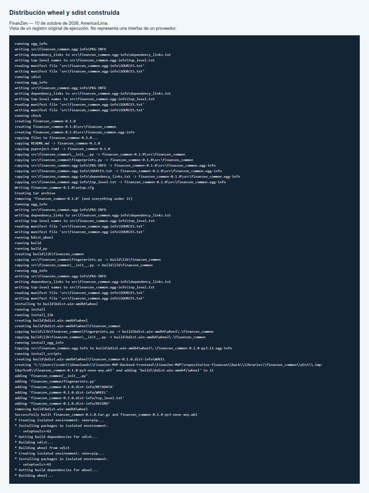

[Registro original del build](../evidencias/cierre-sprint-1/library-build.txt), [pruebas de consumo/compatibilidad](https://github.com/1ASI0657-2620-9199/back/blob/v0.1.1/tests/test_common.py), [paquetes descargables en la release](https://github.com/1ASI0657-2620-9199/back/releases/tag/v0.1.1) y [prueba pública de compatibilidad](../evidencias/cierre-sprint-1/legacy-idempotency.json). La biblioteca se distribuye desde GitHub; no se declara una publicación en PyPI. Los módulos propuestos de eventos/errores no forman parte de este paquete.

### 5.1.4. Framework Pattern Driven Refactoring Report

| Antes | Después | Evidencia |
| --- | --- | --- |
| Repository abría conexiones SQLite directamente | Database / DatabaseSession adaptan SQLite/PostgreSQL y administran transacciones | [comparación del adaptador](https://github.com/1ASI0657-2620-9199/back/compare/8acb9b29b3086010ac4e13fad26519ced425024f...f218113d0e8cc4f2f431d4573eac40e47cbb0ee3) |
| `_request_hash` implementaba JSON + SHA-256 dentro del Repository | Delega en FingerprintService de una biblioteca instalable con Strategy | [diff de extracción](https://github.com/1ASI0657-2620-9199/back/commit/9e9e9f9) |
| Pruebas API y persistencia | Doce casos y seis escenarios BDD, con build del paquete en CI | [CI](https://github.com/1ASI0657-2620-9199/back/actions/runs/38041971339) |

Se conserva el formato de la huella; [el replay público de un registro anterior](../evidencias/cierre-sprint-1/legacy-idempotency.json) confirma compatibilidad después de desplegar la nueva versión. La API puede ejecutarse sin archivos del frontend. La normalización completa de errores, casos de uso separados, Correlation ID y publicación de eventos no se presentan como refactorizaciones realizadas.

## 5.2. Software Configuration Management

La configuración versionada permite instalar, validar y publicar el backend. Los repositorios son independientes y la rama main contiene la release desplegada; las credenciales se configuran fuera del código y del reporte.

### 5.2.1. Software Development Environment Configuration

| Herramienta | Uso / versión verificada | Acceso o instalación |
| --- | --- | --- |
| Python | 3.11.9; backend y scripts | [Python](https://www.python.org/downloads/) |
| FastAPI / Pydantic / Uvicorn | 0.122.0 / 2.12.5 / 0.38.0 | [FastAPI](https://fastapi.tiangolo.com/); requirements.txt |
| PostgreSQL / pg8000 | 17 / 1.31.5; persistencia y CI | [PostgreSQL](https://www.postgresql.org/download/); requirements.txt |
| pytest / httpx | 8.3.5 / 0.28.1; integración | [pytest](https://docs.pytest.org/en/stable/); requirements.txt |
| Behave / build | 1.3.3 / 1.4.0; Gherkin y distribución | [Behave](https://behave.readthedocs.io/en/stable/); requirements-dev.txt |
| Git / GitHub | Versionado, ramas, PR, release y CI | [Git](https://git-scm.com/downloads); [organización](https://github.com/orgs/1ASI0657-2620-9199/repositories) |
| Postman / Newman | Colección HTTP y runner | [Postman](https://www.postman.com/downloads/); [Newman](https://learning.postman.com/docs/collections/using-newman-cli/installing-running-newman/) |
| Trello | Sprint Backlog / Kanban | [Board público](https://trello.com/b/BIj8fpkf/finanzen-sprint-1) |
| Render / Neon | API Free / PostgreSQL Free | [Render](https://dashboard.render.com/); [Neon](https://console.neon.tech/) |
| Structurizr / PlantUML | Deployment DSL y render SVG/PNG | [Structurizr](https://docs.structurizr.com/); [PlantUML](https://plantuml.com/) |
| Node.js / Chrome / Playwright | Capturas y grabación de evidencia | [Node.js](https://nodejs.org/en/download); [Chrome](https://www.google.com/chrome/); [Playwright](https://playwright.dev/docs/intro) |

Desde back:

```powershell
python -m venv .venv
.\.venv\Scripts\python.exe -m pip install -r requirements-dev.txt
.\.venv\Scripts\python.exe -m pytest -q -p no:cacheprovider
.\.venv\Scripts\python.exe -m behave features --junit --junit-directory reports/bdd
.\.venv\Scripts\python.exe -m uvicorn app.main:app --host 127.0.0.1 --port 8000
```

PostgreSQL requiere TEST_DATABASE_URL exclusiva de validación para ejecutar sus tres pruebas. El frontend incorporado utiliza HTML/CSS/JavaScript; landing y mobile siguen preparados sin implementación, según alcance indicado. Kafka, Angular, Flutter y C# del diseño original no se declaran implementados.

### 5.2.2. Source Code Management

La [organización](https://github.com/orgs/1ASI0657-2620-9199/repositories) agrupa [back](https://github.com/1ASI0657-2620-9199/back), [front](https://github.com/1ASI0657-2620-9199/front), [report](https://github.com/1ASI0657-2620-9199/report), [landing](https://github.com/1ASI0657-2620-9199/landing) y [mobile](https://github.com/1ASI0657-2620-9199/mobile).

**GitFlow realizado en back:** main → develop → feature/us01-common-library-bdd → develop mediante [PR #1](https://github.com/1ASI0657-2620-9199/back/pull/1); release/0.1.1 → main mediante [PR #2](https://github.com/1ASI0657-2620-9199/back/pull/2); release/0.1.1 → develop mediante [PR #3](https://github.com/1ASI0657-2620-9199/back/pull/3). Las integraciones se realizaron después de CI aprobada. La [etiqueta y release v0.1.1](https://github.com/1ASI0657-2620-9199/back/releases/tag/v0.1.1) aplican SemVer; la biblioteca conserva su versión 0.1.0.

Convenciones: feature/&lt;historia&gt;-&lt;descripcion&gt;, release/&lt;MAJOR.MINOR.PATCH&gt; y hotfix/&lt;incidencia&gt;-&lt;descripcion&gt;. Se utilizaron feat:, test:, fix: y chore:; hotfix permanece reservado, sin inventar una incidencia. Los PR y merges se gestionaron con la cuenta Darkdren; no se atribuye una revisión por pares que no exista. Front y report conservan su propio historial; no se afirma que todos los componentes ya hayan adoptado GitFlow.

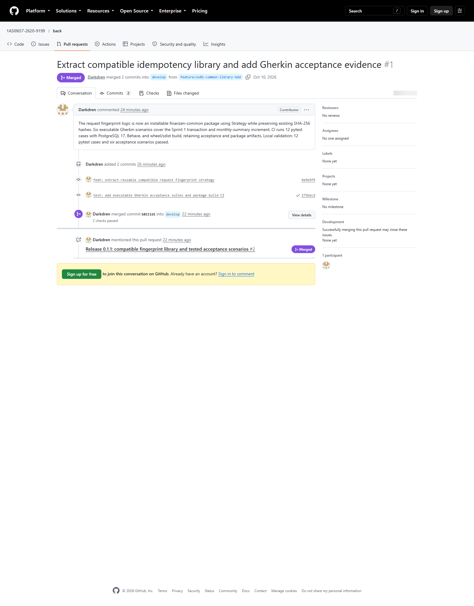

[Registro de ramas, commits y contribuidores](../evidencias/cierre-sprint-1/github-collaboration.json), [release y assets](../evidencias/cierre-sprint-1/github-release.json), [integración feature](../evidencias/cierre-sprint-1/feature-merge.json), [release](../evidencias/cierre-sprint-1/release-merge.json), [sincronización develop](../evidencias/cierre-sprint-1/develop-sync.json).

### 5.2.3. Source Code Style Guide & Conventions

| Convención | Ejemplo |
| --- | --- |
| Funciones/módulos snake_case y nombres en inglés | create_transaction, request_summary, fingerprints.py |
| Clases PascalCase | TransactionCreate, FinancialRecordsRepository, FingerprintService |
| Constantes en mayúsculas | MONTH_PATTERN |
| Tipos explícitos | Decimal, str \| None, FingerprintStrategy |
| REST versionado y recursos plurales | /api/v1/transactions |
| Gherkin por comportamiento | Given / When / Then, tags @US01 / @PF02 / @local |
| Mensajes de commit | feat:, test:, fix:, chore: |

Referencias: [PEP 8](https://peps.python.org/pep-0008/), [PEP 257](https://peps.python.org/pep-0257/), [Gherkin](https://cucumber.io/docs/gherkin/reference/), [Conventional Commits](https://www.conventionalcommits.org/en/v1.0.0/) y [SemVer](https://semver.org/). Los escenarios describen resultados observables, emplean datos sintéticos únicos y no acreditan autenticación por usar X-User-Id. CI ejecuta pruebas y build; no se afirma haber ejecutado linter, formatter ni auditoría estática de estilo.

### 5.2.4. Software Deployment Configuration

**Render Free + Neon Free**, API [https://finanzen-financial-records.onrender.com](https://finanzen-financial-records.onrender.com), [Swagger](https://finanzen-financial-records.onrender.com/docs), [health](https://finanzen-financial-records.onrender.com/health) y [OpenAPI](https://finanzen-financial-records.onrender.com/openapi.json). API 0.1.1 publicada desde main en commit f9d837e.

| Recurso | Configuración verificada |
| --- | --- |
| Render | srv-db4vl25ckfvc738e4hp0; Web Service Free; Virginia; Python 3.11.9 |
| Build | python -m pip install -r requirements.txt; instala finanzen-common desde el repositorio |
| Arranque | python -m uvicorn app.main:app --host 0.0.0.0 --port $PORT --workers 1 |
| Health check | /health |
| Neon | dawn-bird-07958545; PostgreSQL 17; organización Free; aws-us-east-1 |
| Conexión | DATABASE_URL privada; pooling y TLS verificado con pg8000 |

Pasos reproducibles: clonar back; instalar dependencias; configurar PostgreSQL en Neon; suministrar DATABASE_URL como secreto de Render; publicar main y validar health/Swagger/OpenAPI; ejecutar las suites y comprobar persistencia. [render.yaml](https://github.com/1ASI0657-2620-9199/back/blob/v0.1.1/render.yaml) y [DEPLOYMENT.md](https://github.com/1ASI0657-2620-9199/back/blob/v0.1.1/DEPLOYMENT.md) detallan el procedimiento. Render falla al arrancar sin DATABASE_URL; SQLite queda reservado al desarrollo local. No se usa disco de pago.

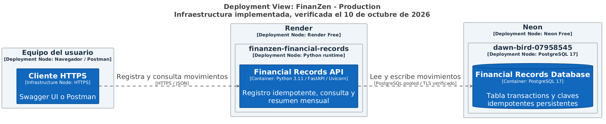

Fuente editable [deployment.dsl](../arquitectura/deployment.dsl), [SVG](../arquitectura/deployment.svg) y [export PlantUML](../arquitectura/export/structurizr-FinanZenDeployment.puml). El DSL se validó con Structurizr CLI 2025.11.09 y se renderizó con PlantUML 1.2026.8; [validación original](../evidencias/cierre-sprint-1/structurizr-validation.txt) y [export original](../evidencias/cierre-sprint-1/structurizr-export.txt). La imagen representa la infraestructura implementada, no una captura de consola cloud.

El statement enumera AWS/Azure/GCP. Render/Neon fue la alternativa gratuita elegida; la aceptación académica de esta diferencia requiere confirmación del docente, que no se inventa.

## 5.3. Microservices Implementation

Este sprint publica un servicio de registros financieros. Se documentan su alcance, pruebas, contrato, despliegue y colaboración observable; no se afirma haber desplegado todos los bounded contexts del diseño original.

### 5.3.1. Sprint 1

Objetivo: registrar ingresos/egresos idempotentes, consultar movimientos por identidad lógica y obtener el resumen mensual, con pruebas, documentación y persistencia remota verificadas.

#### 5.3.1.1. Sprint Backlog 1

El [board público Trello](https://trello.com/b/BIj8fpkf/finanzen-sprint-1) presenta US01 y once tareas. La captura y su export real muestran **12 tarjetas en DONE**. El objetivo corresponde al recorte de registro de movimientos; cuentas/saldos iniciales y otros criterios de la historia completa no se acreditan por esta marca.

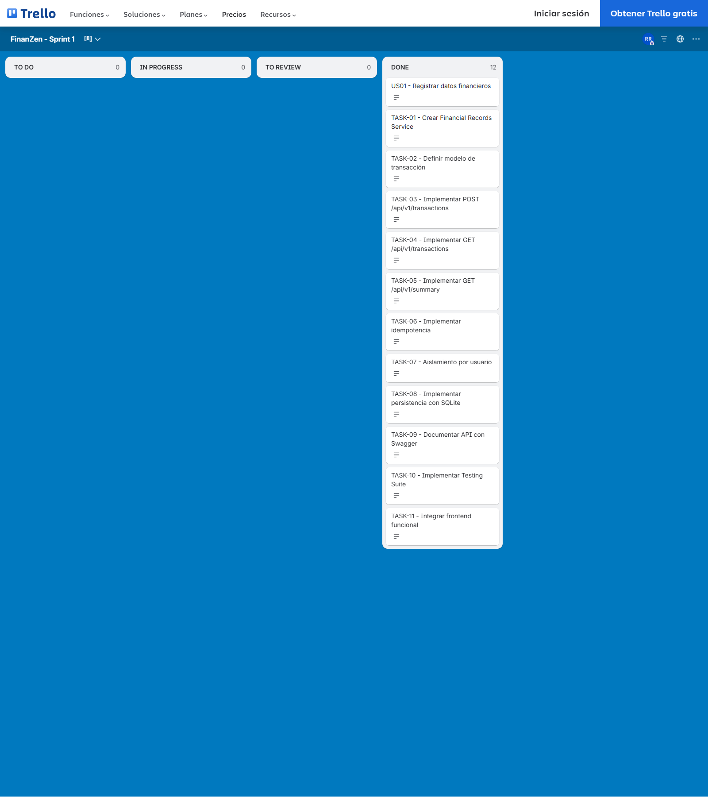

| User Story | Task | Descripción | Estimación | Responsable en descripción | Estado del board |
| --- | --- | --- | --- | --- | --- |
| US01 (recorte del Sprint) | [TASK-01 - Crear Financial Records Service](https://trello.com/c/XOrqEx1p/2-task-01-crear-financial-records-service) | Implementar la estructura inicial del microservicio utilizando Python y FastAPI. | 3 horas | Renzo Revilla | DONE |
| US01 (recorte del Sprint) | [TASK-02 - Definir modelo de transacción](https://trello.com/c/cdq5YiiL/3-task-02-definir-modelo-de-transacci%C3%B3n) | Definir el modelo para ingresos y egresos, incluyendo cuenta, tipo, importe, moneda, categoría, fecha y descripción. | 2 horas | Joan Aguirre | DONE |
| US01 (recorte del Sprint) | [TASK-03 - Implementar POST /api/v1/transactions](https://trello.com/c/c0NIcxuz/4-task-03-implementar-post-api-v1-transactions) | Implementar el endpoint para registrar movimientos financieros. | 3 horas | Renzo Revilla | DONE |
| US01 (recorte del Sprint) | [TASK-04 - Implementar GET /api/v1/transactions](https://trello.com/c/HvS31S9K/5-task-04-implementar-get-api-v1-transactions) | Implementar el endpoint para consultar los movimientos correspondientes al usuario. | 2 horas | Rodrigo Oblitas | DONE |
| US01 (recorte del Sprint) | [TASK-05 - Implementar GET /api/v1/summary](https://trello.com/c/NAs3HIGO/6-task-05-implementar-get-api-v1-summary) | Implementar el endpoint para obtener ingresos, egresos, saldo y cantidad de movimientos del periodo. | 3 horas | Joan Aguirre | DONE |
| US01 (recorte del Sprint) | [TASK-06 - Implementar idempotencia](https://trello.com/c/h2T222iQ/7-task-06-implementar-idempotencia) | Incorporar Idempotency-Key para evitar registros duplicados durante reintentos. | 2 horas | Renzo Revilla | DONE |
| US01 (recorte del Sprint) | [TASK-07 - Aislamiento por usuario](https://trello.com/c/qvfWQcwJ/8-task-07-aislamiento-por-usuario) | Utilizar temporalmente X-User-Id para separar las transacciones correspondientes a cada usuario. | 2 horas | Rodrigo Oblitas | DONE |
| US01 (recorte del Sprint) | [TASK-08 - Implementar persistencia con SQLite](https://trello.com/c/2dB1M1PH/9-task-08-implementar-persistencia-con-sqlite) | Implementar persistencia local utilizando SQLite. | 2 horas | Joan Aguirre | DONE |
| US01 (recorte del Sprint) | [TASK-09 - Documentar API con Swagger](https://trello.com/c/uYYotQ1U/10-task-09-documentar-api-con-swagger) | Documentar automáticamente los endpoints REST mediante OpenAPI/Swagger. | 1 hora | Renzo Revilla | DONE |
| US01 (recorte del Sprint) | [TASK-10 - Implementar Testing Suite](https://trello.com/c/sEUdRkUI/11-task-10-implementar-testing-suite) | Implementar pruebas automatizadas para idempotencia, resumen, aislamiento entre usuarios y disponibilidad del frontend. | 3 horas | Joan Aguirre | DONE |
| US01 (recorte del Sprint) | [TASK-11 - Integrar frontend funcional](https://trello.com/c/MUC2Cxm5/12-task-11-integrar-frontend-funcional) | Implementar una interfaz básica conectada al microservicio para visualizar y registrar movimientos. | 3 horas | Rodrigo Oblitas | DONE |

US01 conserva la estimación de 8 SP indicada en el tablero. Los responsables se extraen de las descripciones de las tarjetas; los arrays idMembers están vacíos y no se presentan como asignaciones de cuentas Trello. [Export original sanitizado](../evidencias/cierre-sprint-1/trello-board.json).

Incrementos adicionales completados: biblioteca reutilizable, BDD local/público, PostgreSQL persistente, release 0.1.1, CI y evidencias de deployment. No se inventan horas ni autores personales para estas acciones automatizadas desde Darkdren; los commits documentan el trabajo. Las tarjetas originales no incluyen todavía ese desglose adicional.

#### 5.3.1.2. Development Evidence for Sprint Review

El incremento conserva el contrato de movimientos, añade una distribución reutilizable y despliega la release 0.1.1. Historial real, fechas en America/Lima:

| Repository | Branch | Commit Id | Commit Message | Commit Message Body | Committed on (Date) |
| --- | --- | --- | --- | --- | --- |
| `1ASI0657-2620-9199/back` | `feature/us01-common-library-bdd` | [9e9e9f9](https://github.com/1ASI0657-2620-9199/back/commit/9e9e9f9e16ce5d35ff8207aa434c7f982f1c8afa) | feat: extract reusable compatible request fingerprint strategy | Sin cuerpo | 2026-10-10 04:29:23-05:00 |
| `1ASI0657-2620-9199/back` | `feature/us01-common-library-bdd` | [275bbcd](https://github.com/1ASI0657-2620-9199/back/commit/275bbcdd87f45fdefe7a0811692fb18ab5afdd7e) | test: add executable Gherkin acceptance suites and package build CI | Sin cuerpo | 2026-10-10 04:29:23-05:00 |
| `1ASI0657-2620-9199/back` | `release/0.1.1` | [53b8961](https://github.com/1ASI0657-2620-9199/back/commit/53b896185a0a1686f7cbb09a91e08b5578a07c40) | chore: prepare backend release 0.1.1 | Sin cuerpo | 2026-10-10 04:33:38-05:00 |
| `1ASI0657-2620-9199/back` | `main` | [f9d837e](https://github.com/1ASI0657-2620-9199/back/commit/f9d837e35b0f15eab7aa02b85c7a0b49a62a8d1b) | chore: release backend 0.1.1 | Release 0.1.1: compatible fingerprint library and tested acceptance scenarios | 2026-10-10 04:36:11-05:00 |

[PR feature](https://github.com/1ASI0657-2620-9199/back/pull/1), [PR release](https://github.com/1ASI0657-2620-9199/back/pull/2), [sincronización develop](https://github.com/1ASI0657-2620-9199/back/pull/3) y [release descargable](https://github.com/1ASI0657-2620-9199/back/releases/tag/v0.1.1). El frontend también recibió [el ajuste de instalación de la biblioteca en CI](https://github.com/1ASI0657-2620-9199/front/commit/ebe4909).


El commit histórico 41ff14d del repositorio platform se conserva como fuente del informe original, no como commit importado al historial actual:

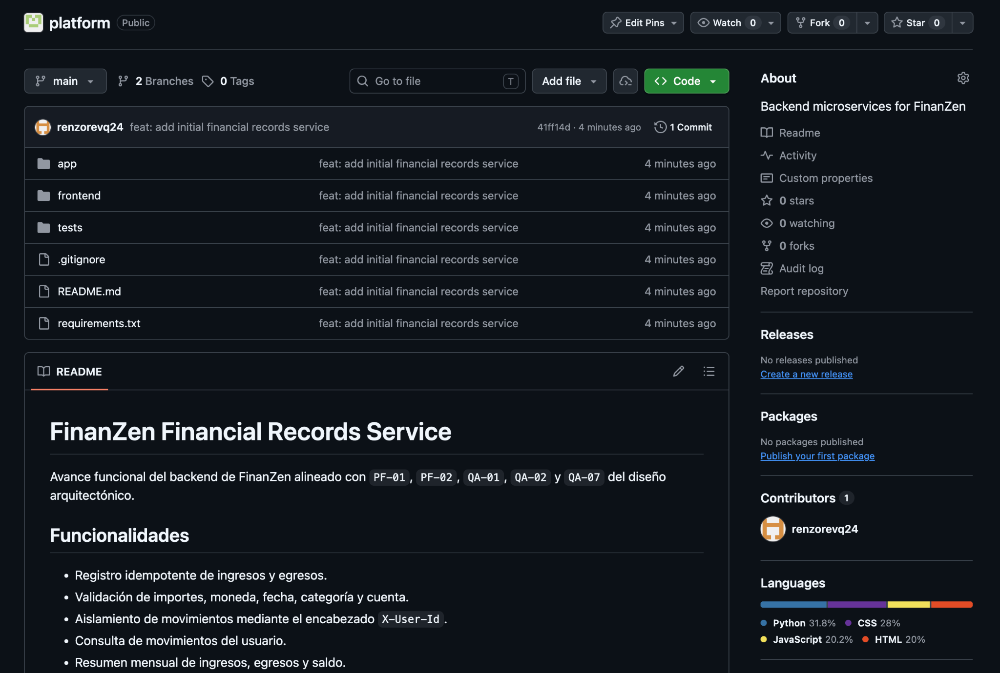

#### 5.3.1.3. Testing Suite Evidence for Sprint Review

**BDD implementado y ejecutado:** seis escenarios locales, 29 pasos aprobados; cinco escenarios públicos, 24 pasos aprobados y el escenario local de recreación excluido. La API pública no se presenta como reiniciada por el runner local. Pytest aprobó doce casos con PostgreSQL real.

| Scenario | Historia / criterio | Resultado observable |
| --- | --- | --- |
| Register an income | US01, recorte de registro | HTTP 201 y monto conservado |
| Retry a registration | US01, idempotencia | HTTP 200, mismo ID y replay=true |
| Reject a reused key | US01, conflicto | HTTP 409 |
| Calculate a monthly summary | PF-02, resumen parcial | 1000.00 − 125.50 = 874.50; otro usuario sin movimientos |
| Reject an invalid calendar month | Validación del contrato | HTTP 422 |
| Preserve identifier after recreating app | US01, persistencia local | mismo ID y ningún duplicado |

| Repository | Branch | Commit Id | Commit Message | Commit Message Body | Committed on (Date) |
| --- | --- | --- | --- | --- | --- |
| `1ASI0657-2620-9199/back` | `feature/us01-common-library-bdd` | [9e9e9f9](https://github.com/1ASI0657-2620-9199/back/commit/9e9e9f9e16ce5d35ff8207aa434c7f982f1c8afa) | feat: extract reusable compatible request fingerprint strategy | Sin cuerpo | 2026-10-10 04:29:23-05:00 |
| `1ASI0657-2620-9199/back` | `feature/us01-common-library-bdd` | [275bbcd](https://github.com/1ASI0657-2620-9199/back/commit/275bbcdd87f45fdefe7a0811692fb18ab5afdd7e) | test: add executable Gherkin acceptance suites and package build CI | Sin cuerpo | 2026-10-10 04:29:23-05:00 |

Código de los escenarios [financial_records.feature](https://github.com/1ASI0657-2620-9199/back/blob/v0.1.1/features/financial_records.feature):

```gherkin
Feature: Financial records acceptance for the Sprint 1 increment
  The current US01 increment registers transactions, and PF-02 provides a
  monthly summary. Budgets, authentication and alerts are outside this feature.

  Background:
    Given a separate demonstration user

  @US01 @create
  Scenario: Register an income without losing its amount
    When I register an income of "1000.00" with key "income-0001"
    Then the API responds with status 201
    And the movement amount is "1000.00"

  @US01 @idempotency
  Scenario: Retry a registration without creating a duplicate
    Given an income of "1000.00" registered with key "income-0001"
    When I repeat the same registration
    Then the API responds with status 200
    And the movement keeps its original identifier
    And the replay header is "true"

  @US01 @conflict
  Scenario: Reject a reused key with different financial content
    Given an income of "1000.00" registered with key "income-0001"
    When I register an income of "2000.00" with key "income-0001"
    Then the API responds with status 409

  @PF02 @summary
  Scenario: Calculate a monthly summary and isolate the demonstration users
    Given an income of "1000.00" registered with key "income-0001"
    And an expense of "125.50" registered with key "expense-0001"
    When I request the monthly summary for "2026-10"
    Then the API responds with status 200
    And income, expenses and balance are "1000.00", "125.50" and "874.50"
    And another demonstration user has no movements

  @validation
  Scenario: Reject an invalid calendar month
    When I request the monthly summary for "2026-13"
    Then the API responds with status 422

  @local @US01 @persistence
  Scenario: Preserve the identifier after recreating the local application
    Given an income of "1000.00" registered with key "income-0001"
    When I recreate the local application and repeat the registration
    Then the API responds with status 200
    And the movement keeps its original identifier
```

[Pasos ejecutables](https://github.com/1ASI0657-2620-9199/back/blob/v0.1.1/features/steps/financial_records.py) y [entorno aislado](https://github.com/1ASI0657-2620-9199/back/blob/v0.1.1/features/environment.py).

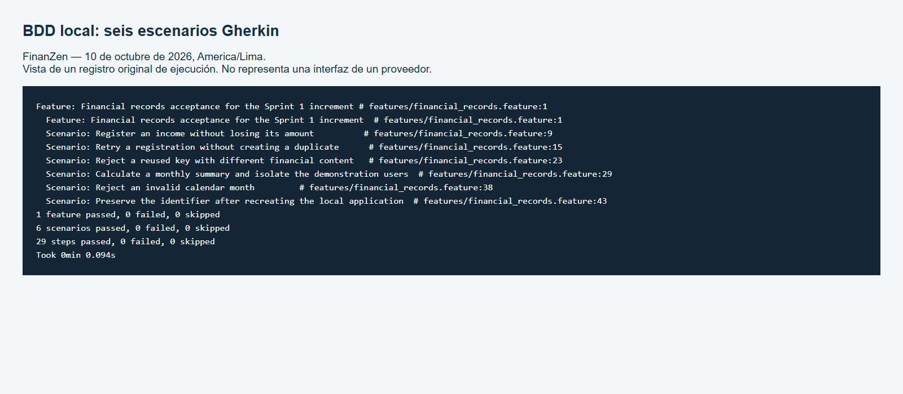

[Log local](../evidencias/cierre-sprint-1/bdd-local.txt), [log público](../evidencias/cierre-sprint-1/bdd-public.txt) y [CI aprobada](https://github.com/1ASI0657-2620-9199/back/actions/runs/38041971339). El workflow publica JUnit y distribuciones como artefactos. Comando público: `python -m behave features --tags="not @local" -D base_url=https://finanzen-financial-records.onrender.com`.

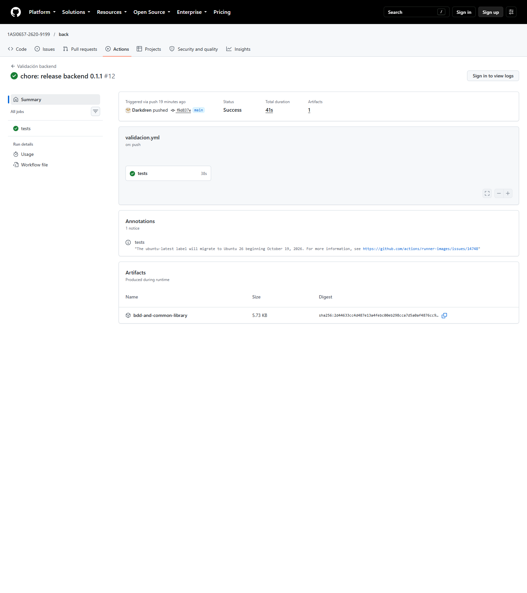

#### 5.3.1.4. Execution Evidence for Sprint Review

La colección Postman del Sprint 1 se ejecutó con Newman contra la API pública 0.1.1: **ocho solicitudes, once aserciones, cero fallos**. [Colección](../evidencias/sprint-1/FinanZen-Sprint1.postman_collection.json), [resultado original](../evidencias/cierre-sprint-1/publico/newman.json) y [salida](../evidencias/cierre-sprint-1/publico/newman.txt).

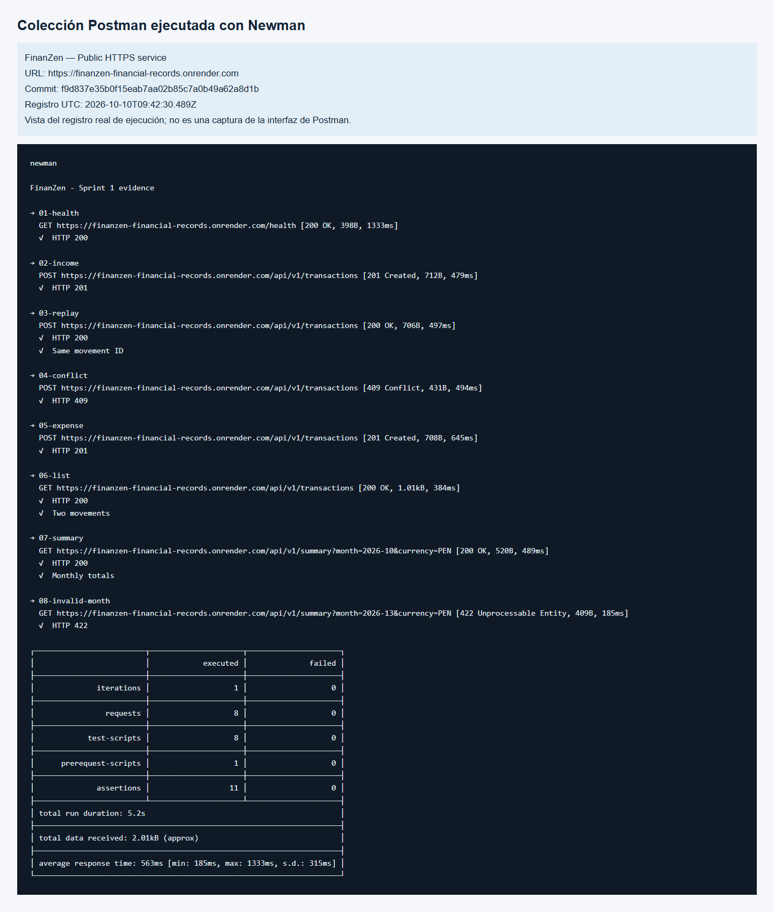

| Operación pública | Resultado |
| --- | --- |
| GET /health | 200, servicio operativo |
| POST /api/v1/transactions | 201, ingreso creado |
| Repetir el POST | 200, mismo ID, replay=true |
| Reutilizar clave con otro monto | 409 |
| GET /api/v1/transactions | 200, dos movimientos del usuario sintético |
| GET /api/v1/summary?month=2026-10&currency=PEN | 200; income=1000.00, expenses=125.50, balance=874.50 |

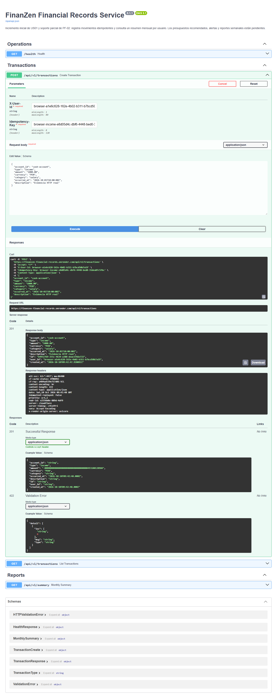

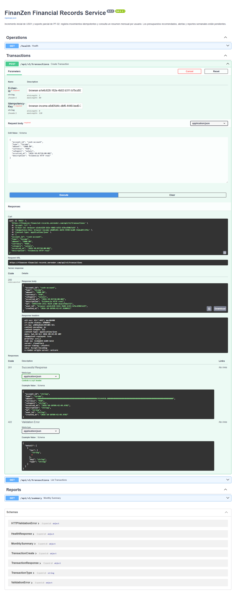

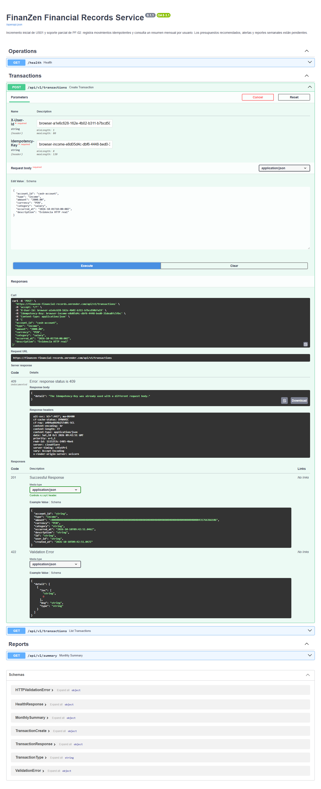

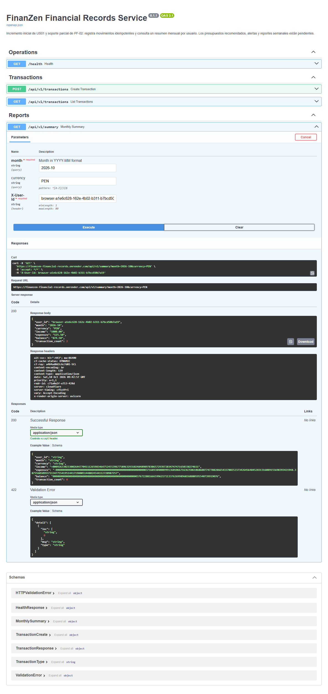

Se adjunta [video explicativo con voz sintética y capturas reales](../evidencias/cierre-sprint-1/demostracion-explicada.mp4), con [guion, fuentes y marcas de tiempo](../evidencias/cierre-sprint-1/video-timeline.json), y [grabación real de la interacción Swagger](../evidencias/cierre-sprint-1/publico/demostracion.webm). Los datos son sintéticos. La narración no se atribuye a un integrante.

Las capturas de Postman Desktop de la fuente se mantienen como antecedente local; la ejecución nueva de la colección corresponde a Newman y las imágenes HTTP actuales a Swagger. No se presentan como capturas nuevas de Postman Desktop:

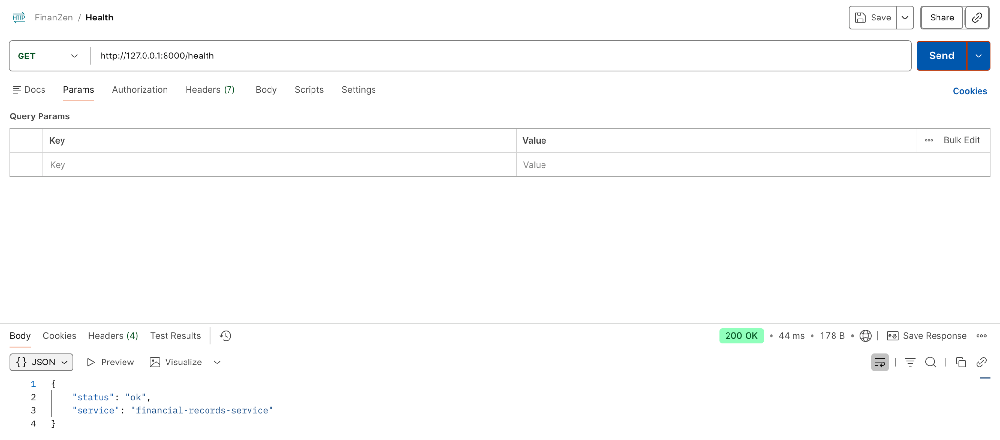

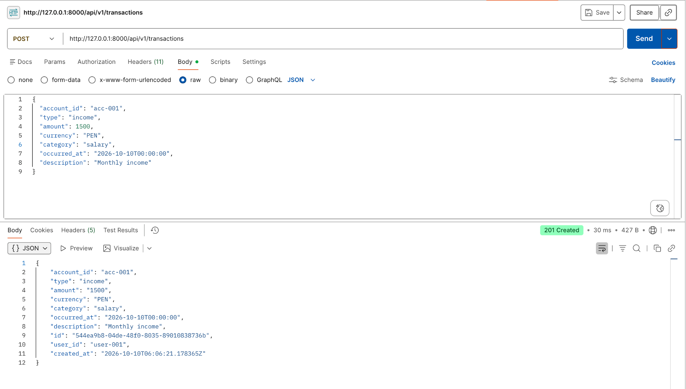

#### 5.3.1.5. Microservices Documentation Evidence for Sprint Review

FastAPI publica OpenAPI 3.1.0 y API 0.1.1. [Swagger público](https://finanzen-financial-records.onrender.com/docs), [contrato desplegado](https://finanzen-financial-records.onrender.com/openapi.json), [contrato capturado](../evidencias/cierre-sprint-1/openapi.json) y [repositorio de Web Services](https://github.com/1ASI0657-2620-9199/back/tree/v0.1.1/app).

| Método y sintaxis | Parámetros / cabeceras | Acción y ejemplo de respuesta | Documentación |
| --- | --- | --- | --- |
| GET /health | Ninguno | 200: status=ok, service=financial-records-service | [Health](https://finanzen-financial-records.onrender.com/docs#/Operations/health_health_get) |
| POST /api/v1/transactions | X-User-Id; Idempotency-Key; JSON account_id, type, amount, currency, category, occurred_at, description | 201: movimiento con id y created_at; 200 replay con mismo id; 409 clave con otro contenido; 422 entrada inválida | [Registro](https://finanzen-financial-records.onrender.com/docs#/Transactions/create_transaction_api_v1_transactions_post) |
| GET /api/v1/transactions | X-User-Id | 200: array de movimientos de la identidad lógica; [] cuando no hay registros | [Listado](https://finanzen-financial-records.onrender.com/docs#/Transactions/list_transactions_api_v1_transactions_get) |
| GET /api/v1/summary?month=2026-10&currency=PEN | X-User-Id; month YYYY-MM; currency, PEN por defecto | 200: income=1000.00, expenses=125.50, balance=874.50, transaction_count=2; 422 mes/moneda inválidos | [Resumen](https://finanzen-financial-records.onrender.com/docs#/Reports/monthly_summary_api_v1_summary_get) |

Solicitud de ejemplo, sustituir la identidad/clave por un usuario sintético nuevo:

```json
{"account_id":"cash-account","type":"income","amount":"1000.00","currency":"PEN","category":"salary","occurred_at":"2026-10-01T10:00:00Z","description":"Evidencia HTTP real"}
```

El tipo admite income/expense, amount usa Decimal positivo, currency requiere tres letras mayúsculas y occurred_at es fecha-hora. La respuesta agrega id, user_id y created_at. Idempotent-Replayed señala si el POST es una repetición. X-User-Id es identidad de demostración; no OAuth/JWT. No se incorporan PUT/PATCH/DELETE como operaciones que no existen.

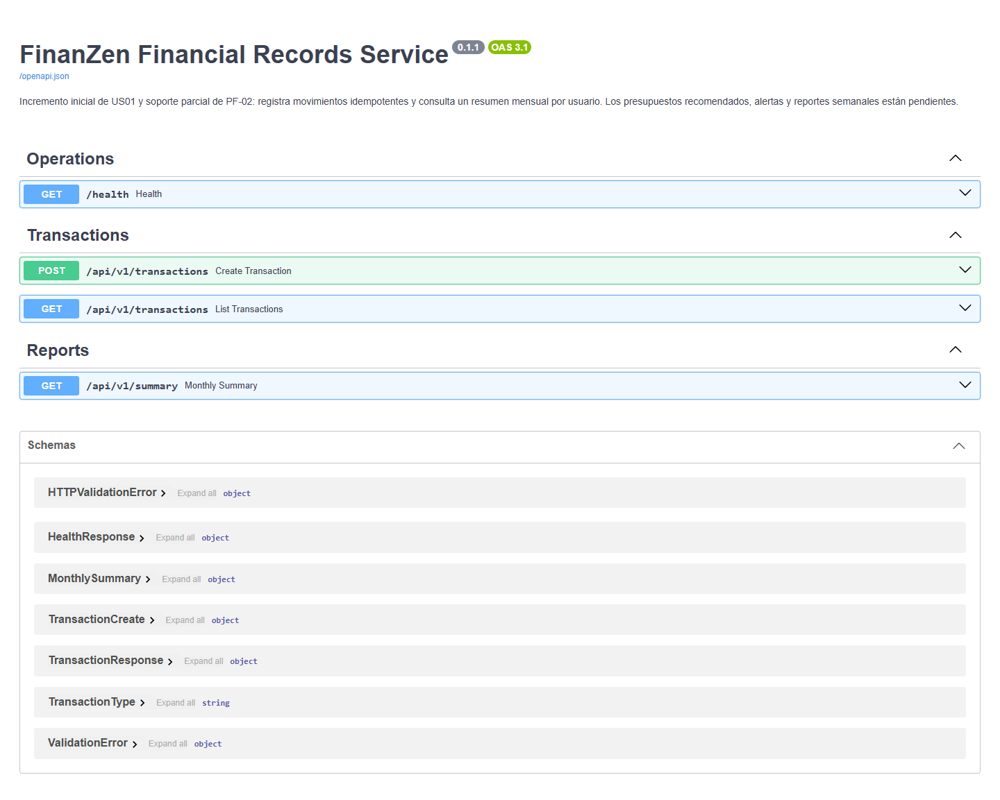

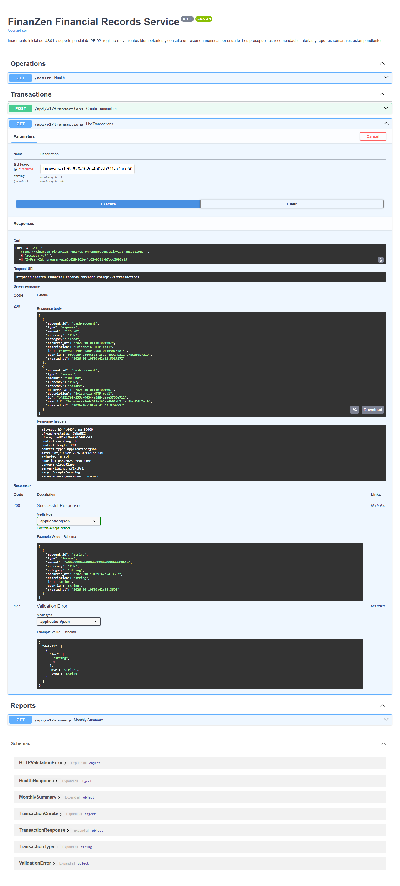

[Respuestas HTTP originales](../evidencias/cierre-sprint-1/publico/swagger-http.json). Commits relacionados con documentación/contrato:

| Repository | Branch | Commit Id | Commit Message | Commit Message Body | Committed on (Date) |
| --- | --- | --- | --- | --- | --- |
| `1ASI0657-2620-9199/back` | `release/0.1.1` | [53b8961](https://github.com/1ASI0657-2620-9199/back/commit/53b896185a0a1686f7cbb09a91e08b5578a07c40) | chore: prepare backend release 0.1.1 | Sin cuerpo | 2026-10-10 04:33:38-05:00 |

#### 5.3.1.6. Software Deployment Evidence for Sprint Review

**Despliegue vigente realizado:** Render Free + Neon Free; [API pública](https://finanzen-financial-records.onrender.com), versión 0.1.1. Deploy `dep-db50emvlot8c73d9e8p0`, estado **live**, commit `f9d837e35b0f15eab7aa02b85c7a0b49a62a8d1b`; finalización UTC `2026-10-10T09:38:09.875688Z`. [Registro original de la release desplegada](../evidencias/cierre-sprint-1/render-release-deploy.json).

Se construyó e instaló el paquete finanzen-common junto con requirements.txt; el servicio arrancó con Uvicorn y mantuvo DATABASE_URL privada. Health/Swagger/OpenAPI respondieron 200. Gherkin público aprobó cinco escenarios y Newman once aserciones. [Compatibilidad pública con un movimiento creado antes de la release](../evidencias/cierre-sprint-1/legacy-idempotency.json): HTTP 200, mismo ID, replay=true y saldo 874.50 conservado.

La evidencia del despliegue inicial y del reinicio real de Render sigue disponible: [servicio Free](../evidencias/deployment/publico/render-service.json), [Neon Free](../evidencias/deployment/publico/neon-resources.json), [build](../evidencias/deployment/publico/render-build-logs.json), [reinicio](../evidencias/deployment/publico/reinicio-solicitud.json), [runtime](../evidencias/deployment/publico/render-runtime-logs.json) y [datos antes/después](../evidencias/deployment/publico/persistencia.json). Esa prueba usó otro usuario sintético con ingreso 105.00, egreso 12.34 y saldo 92.66.

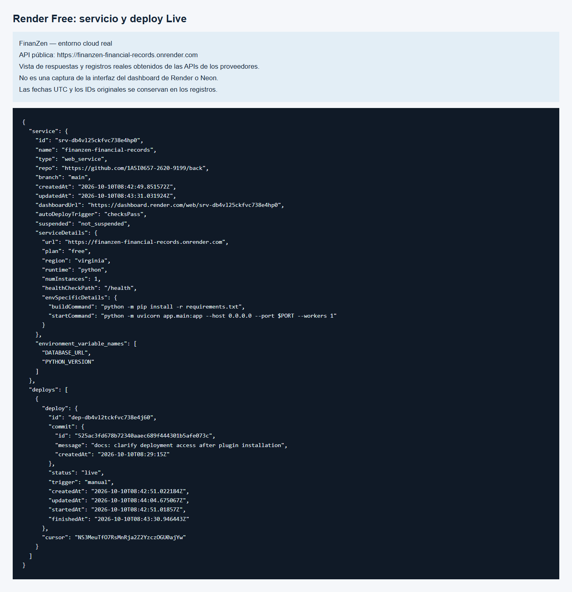

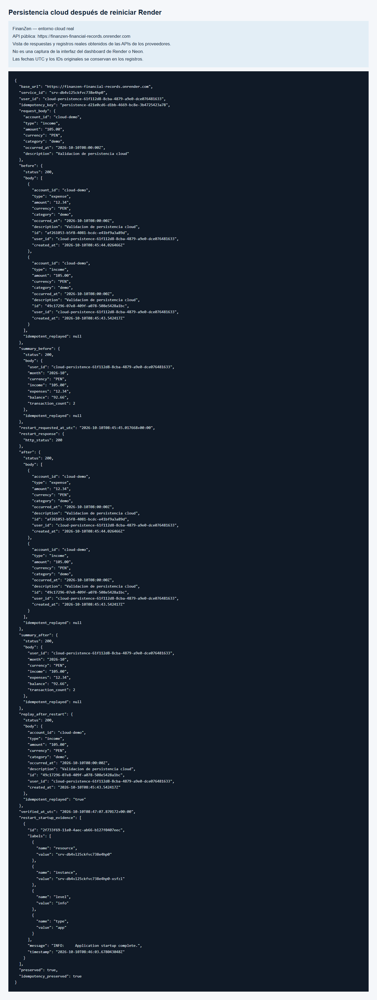

El [índice del cierre](../evidencias/cierre-sprint-1/README.md) relaciona las nuevas evidencias. Los registros no contienen credenciales; los diagramas y vistas de metadatos se identifican y no se presentan como dashboards. La aceptación de Render/Neon frente al listado AWS/Azure/GCP del statement requiere validación del docente.

#### 5.3.1.7. Team Collaboration Insights during Sprint

El equipo conserva en el backlog público los responsables Rodrigo Oblitas, Renzo Revilla y Joan Aguirre, según las descripciones de Trello. El incremento automatizado de esta entrega se publicó desde Darkdren mediante commits, CI, PR y release reales.

| Repositorio | Commits consultados en main | Cuentas contribuidoras verificadas |
| --- | --- | --- |
| back | 11 | Darkdren |
| front | 3 | Darkdren |
| report | 9 | Darkdren |


[Consulta original de GitHub sanitizada](../evidencias/cierre-sprint-1/github-collaboration.json), [PR feature](https://github.com/1ASI0657-2620-9199/back/pull/1), [PR release](https://github.com/1ASI0657-2620-9199/back/pull/2) y [PR de sincronización](https://github.com/1ASI0657-2620-9199/back/pull/3). No existen revisiones por otros integrantes en estos PR al momento de esta comprobación; no se describen como peer review.


**Pendiente del equipo:** relacionar sus cuentas con commits/revisiones reales y evidenciar participación de todos los integrantes en Web Services. El API solo verifica Darkdren en estos historiales; nombres en el backlog no prueban autoría de código. No se inventan reuniones, horas ni contribuciones para completar este criterio.

#### 5.3.1.8. Kanban Board

[FinanZen — Sprint 1, Trello público](https://trello.com/b/BIj8fpkf/finanzen-sprint-1). Captura del 10 de octubre de 2026: TO DO=0, IN PROGRESS=0, TO REVIEW=0, DONE=12. Las descripciones incluyen responsables y estimaciones; las tarjetas no tienen idMembers asignados. La captura representa el tablero real y no una reconstrucción.


[Export del tablero](../evidencias/cierre-sprint-1/trello-board.json). El backlog y el alcance se explican en 5.3.1.1. Los nuevos incrementos de biblioteca/BDD/release todavía no tienen tarjetas adicionales en ese tablero; se trazan mediante los PR y commits del reporte.

### 5.3.3. Sprint 3 — Smart Device Integration and Consumption Telemetry

Actualización documental verificada el **26 de noviembre de 2026**, zona horaria **America/Lima**. Los apartados siguientes corresponden a las evidencias de desarrollo, ejecución y despliegue solicitadas para Sprint 3. Conservan el contenido anterior del Sprint 1 y utilizan la implementación integrada de Financial Records, Budget, Notification y Device Integration.

#### 5.3.3.2. Development Evidence for Sprint Review

Se implementó una ejecución distribuida local con Docker Compose: cuatro aplicaciones FastAPI en contenedores independientes, Apache Kafka como Event Bus y Nginx para el frontend y el enrutamiento HTTP. La imagen `finanzen-api:dev` se reutiliza con comandos ASGI diferentes por servicio; cada contenedor monta su propia persistencia. Device Integration recibe lecturas, normaliza Wh/kWh mediante adaptadores y conserva la telemetría separada de los movimientos financieros.

El archivo versionado se llama **`compose.yaml`**; es el archivo de Docker Compose que cumple el papel del `docker-compose.yml` mencionado en el backlog. La evidencia conserva el nombre real del repositorio.

| Artefacto versionado | Implementación verificable |
| --- | --- |
| [Dockerfile del backend](https://github.com/1ASI0657-2620-9199/back/blob/f0846ceb886650b425d22ad1c4f940db5915e5f3/Dockerfile) | Python 3.11, instalación de dependencias y biblioteca común, usuario de ejecución sin privilegios, puerto 8000, health check HTTP y etapa independiente de pruebas. |
| [compose.yaml](https://github.com/1ASI0657-2620-9199/back/blob/f0846ceb886650b425d22ad1c4f940db5915e5f3/compose.yaml) | Cuatro APIs, Kafka 4.1.2 en KRaft, Nginx, dependencias de arranque, health checks y cinco volúmenes. Incluye dos tareas de inicialización de Kafka. |
| [Dockerfile del frontend](https://github.com/1ASI0657-2620-9199/front/blob/b0998d931bb5d29771de3a849f8b9118c2a0a6bc/Dockerfile) | Imagen Nginx con los archivos HTML, CSS y JavaScript del panel. |
| [nginx.conf](https://github.com/1ASI0657-2620-9199/front/blob/b0998d931bb5d29771de3a849f8b9118c2a0a6bc/nginx.conf) | Enrutamiento de las operaciones a cada API y acceso a Swagger mediante prefijos por servicio. |
| [Publicador y consumidores Kafka](https://github.com/1ASI0657-2620-9199/back/blob/f0846ceb886650b425d22ad1c4f940db5915e5f3/app/kafka_transport.py) | Publicación de Outbox con confirmación de Kafka, consumo idempotente, confirmación del offset después de persistir y envío de mensajes inválidos a DLQ. |

La trazabilidad se verificó con Git en CMD y con los archivos presentes en las ramas publicadas. Los commits de configuración e integración son:

| Repositorio | Commit | Fecha | Evidencia de desarrollo |
| --- | --- | --- | --- |
| back | [f92595e](https://github.com/1ASI0657-2620-9199/back/commit/f92595e) | 2026-11-26 | `feat: implement Sprint 2 and 3 APIs with Docker and Kafka`: incorpora Dockerfile, Compose, servicios, broker y verificadores. |
| front | [d9af8bd](https://github.com/1ASI0657-2620-9199/front/commit/d9af8bd) | 2026-11-26 | `feat: add budgets alerts devices and reports to the web panel`: incorpora el panel, Dockerfile de Nginx y configuración del gateway. |
| back | [f0846ce](https://github.com/1ASI0657-2620-9199/back/commit/f0846ce) | 2026-11-26 | Integración de las APIs y Kafka en main, conservando también el historial de develop. |
| front | [b0998d9](https://github.com/1ASI0657-2620-9199/front/commit/b0998d9) | 2026-11-26 | Integración del frontend de Sprint 2 y 3 en main. |

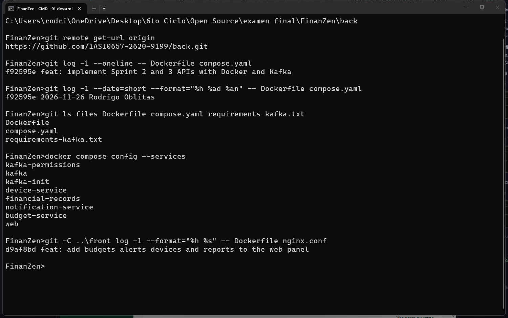

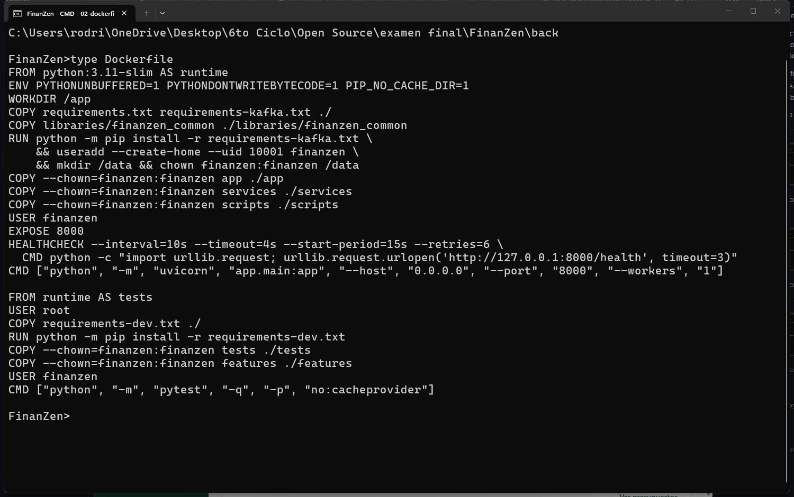

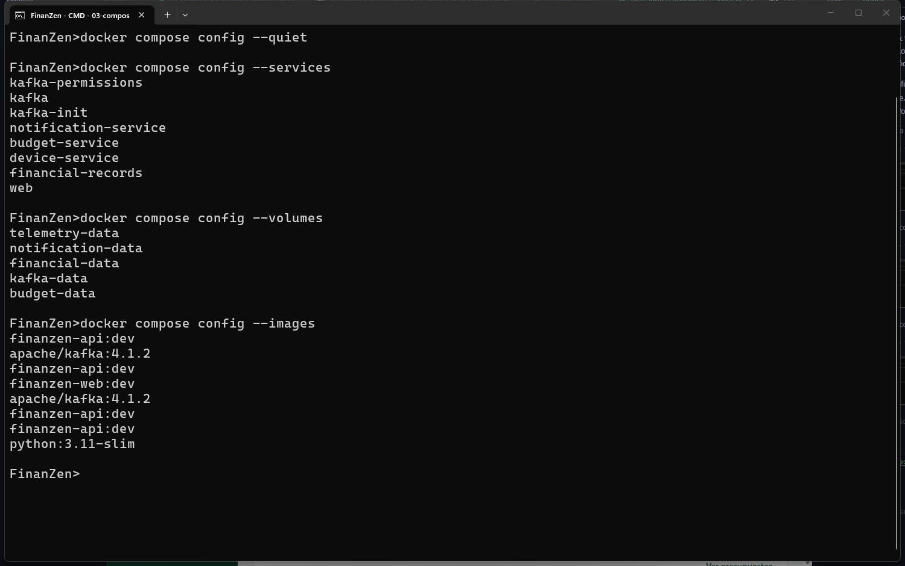

Se conservan [copias de los archivos de configuración](../evidencias/sprint-3/docker/fuentes-configuracion/) y un [registro de versiones y hashes](../evidencias/sprint-3/docker/configuracion-versionada.json) para relacionar la configuración capturada con el código publicado.

#### 5.3.3.4. Execution Evidence for Sprint Review

La ejecución se comprobó en una sesión **CMD local**, con el backend y el frontend de FinanZen y el stack Docker en funcionamiento. Se observaron **seis contenedores activos y saludables**: Financial Records, Budget, Notification, Device Integration, Kafka y Nginx. Las tareas `kafka-init` y `kafka-permissions` terminaron con código 0; su función es inicializar recursos antes de iniciar las aplicaciones.

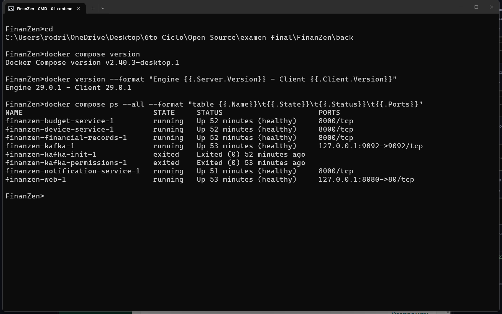

Desde esa misma aplicación de terminal se ejecutó:

~~~cmd
.\.venv\Scripts\python.exe scripts\verify_docker.py
~~~

El verificador realizó llamadas HTTP al gateway y publicó/consumió eventos del broker real. La ejecución terminó con código **0** y registró **siete comprobaciones aprobadas**:

| Comprobación ejecutada | Resultado observado |
| --- | --- |
| APIs y Swagger de los cuatro servicios | Aplicaciones independientes accesibles a través de Nginx y con transporte Kafka declarado. |
| Movimiento → presupuesto → alerta | TransactionRecorded actualiza el presupuesto y BudgetThresholdReached produce una notificación in-app entregada. |
| Repetición HTTP y reentrega Kafka | Se conserva el movimiento original y no se suma dos veces el gasto. |
| Telemetría normalizada e idempotente | Una lectura de 25000 Wh se registra como 25 kWh; reenviarla mantiene una lectura única y no crea una transacción financiera. |
| Mensaje inválido | Cinco intentos fallidos de procesamiento antes de su publicación en la DLQ de Kafka. |
| Outbox y resultado de entrega | Los Outbox quedan sin eventos pendientes y NotificationDelivered se observa en Kafka. |
| Persistencia por servicio | Las cuatro bases utilizan volúmenes Docker distintos. |

El usuario sintético de esta ejecución fue **`docker-44ecf9af`**. El medidor simulado utilizó una tarifa de **S/ 0.75 por kWh**, por lo que los **25 kWh** tuvieron un costo estimado de **S/ 18.75**. El umbral del dispositivo era **20 kWh**. El costo permaneció como estimación de consumo; el único movimiento financiero del escenario fue el gasto registrado expresamente por el verificador.

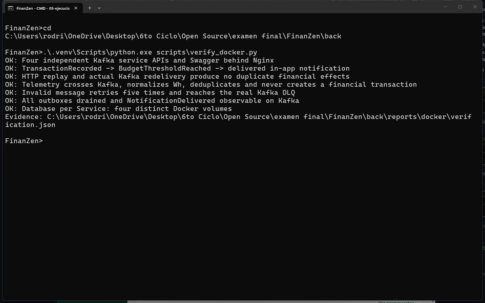

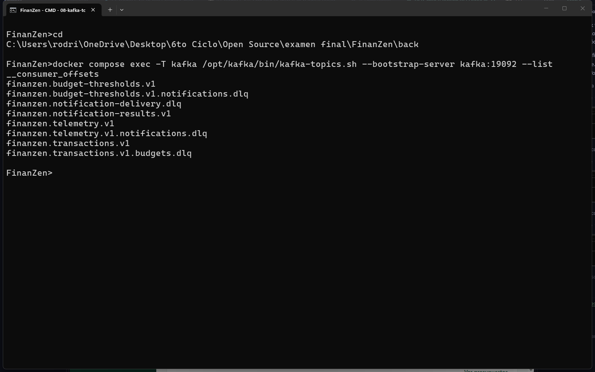

La [salida capturada de CMD](../evidencias/sprint-3/docker/05-ejecucion-integrada.txt) y el [registro JSON de la ejecución](../evidencias/sprint-3/docker/ejecucion-integrada.json) conservan las comprobaciones, el usuario sintético, los eventos y sus posiciones en Kafka. Esta captura corresponde al modo normal del verificador, sin el argumento `--faults`.

#### 5.3.3.6. Software Deployment Evidence for Sprint Review

**Modalidad de despliegue verificada: Docker Desktop local en Windows, con contenedores Linux y Docker Compose.** La captura registra Docker Engine **29.0.1** y Compose **v2.40.3-desktop.1**. El frontend se publica en `http://127.0.0.1:8080`; Kafka dispone de un listener local en `127.0.0.1:9092` y un listener interno en `kafka:19092`.

La puesta en marcha se verificó sobre el stack existente mediante el siguiente comando, que terminó con código 0 y esperó los health checks de las dependencias:

~~~cmd
docker compose --progress quiet up -d --wait --wait-timeout 240
~~~

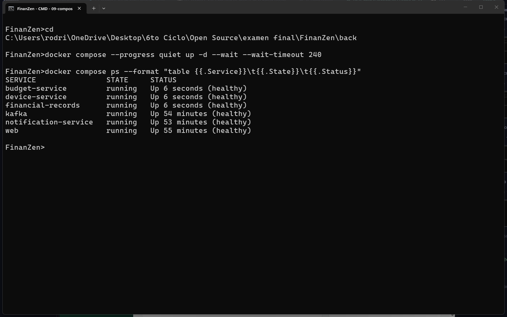

| Servicio activo | Estado capturado | Volumen persistente |
| --- | --- | --- |
| financial-records | running / healthy | finanzen_financial-data |
| budget-service | running / healthy | finanzen_budget-data |
| notification-service | running / healthy | finanzen_notification-data |
| device-service | running / healthy | finanzen_telemetry-data |
| kafka | running / healthy | finanzen_kafka-data |
| web | running / healthy | Archivos estáticos incorporados en su imagen Nginx. |

Los dos inicializadores concluyen con `Exited (0)`; los seis servicios anteriores permanecen activos. Los volúmenes de Financial Records, Budget, Notification y Telemetry son independientes.

Los health checks HTTP se consultaron realmente desde CMD con el [script de verificación](../scripts/verificar_health_docker.py). La evidencia registró:

| Endpoint | HTTP | Estado | Transporte | Outbox pendiente |
| --- | --- | --- | --- | --- |
| /services/financial/health | 200 | ok | kafka | 0 |
| /services/budgets/health | 200 | ok | kafka | 0 |
| /services/notifications/health | 200 | ok | kafka | 0 |
| /services/devices/health | 200 | ok | kafka | 0 |

Todos los trabajadores informados por las cuatro respuestas estaban activos. Las [respuestas completas de health](../evidencias/sprint-3/docker/health-checks.json) conservan los campos originales recibidos por HTTP.

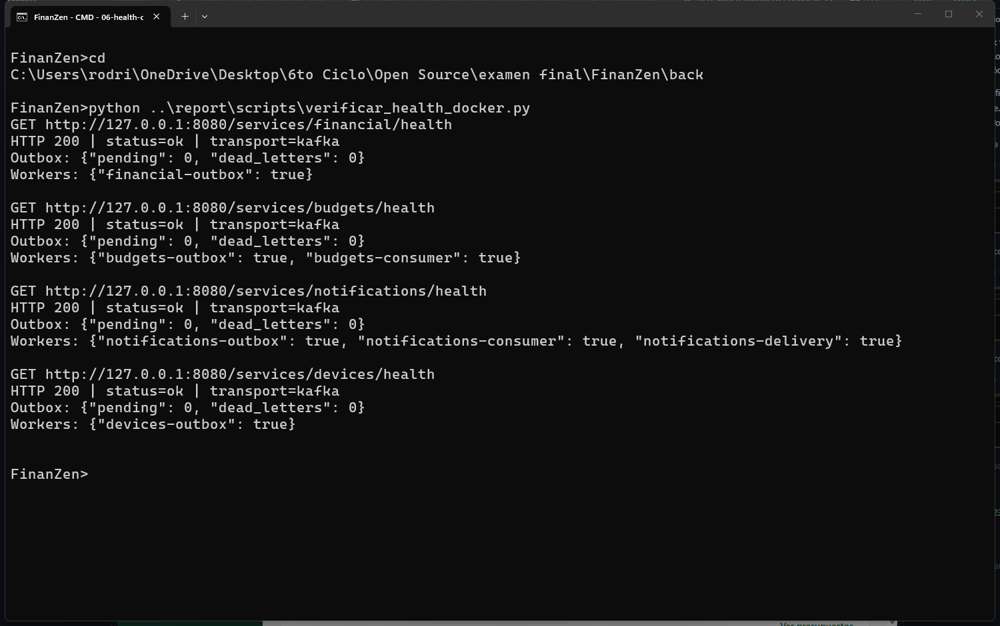

Los logs se obtuvieron directamente de los contenedores con:

~~~cmd
docker compose logs --no-color --tail 6 financial-records budget-service notification-service device-service
~~~

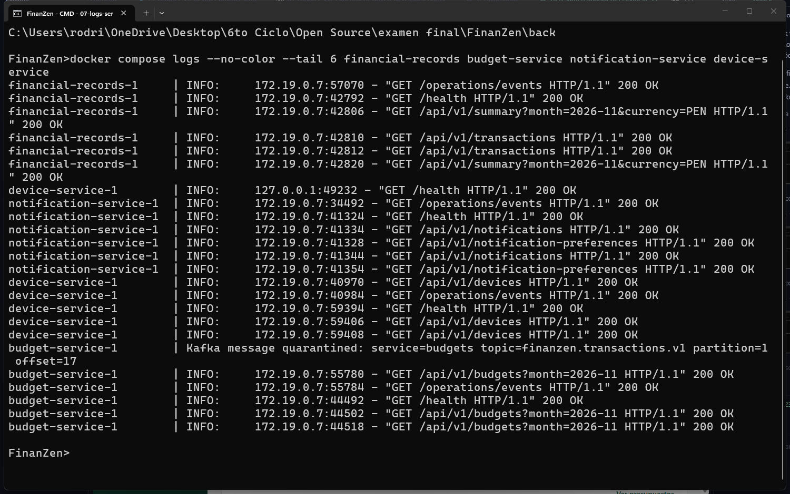

La línea `Kafka message quarantined` de Budget corresponde al mensaje inválido enviado intencionadamente por el verificador para comprobar la DLQ. El [texto capturado de los logs](../evidencias/sprint-3/docker/07-logs-servicios.txt) permite examinar ese registro junto con las respuestas HTTP del escenario.

Las nueve imágenes de estos tres apartados son capturas de una ventana nativa **CMD (cmd.exe)** en el equipo de desarrollo. Se guardaron la [metodología y el índice de evidencias](../evidencias/sprint-3/docker/README.md), las transcripciones del búfer de consola y los metadatos de captura. Las imágenes no se generaron con IA ni se reconstruyeron en una página web.

## Pendientes que requieren evidencia externa

- Participación verificable de todos los integrantes en código y revisiones.
- Aceptación por el docente del proveedor Render/Neon frente al listado académico.
- Capturas nuevas de Postman Desktop si se exige esa interfaz: la ejecución pública actual utiliza la colección Postman con Newman y las capturas HTTP corresponden a Swagger.
- Actualizar las tarjetas Trello con los incrementos adicionales, cuando el equipo gestione su tablero.
- Landing/mobile y los bounded contexts fuera del recorte siguen sin implementación; no se incluyen como logros del Sprint 1.
