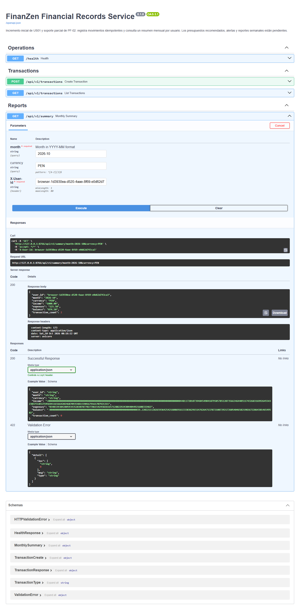
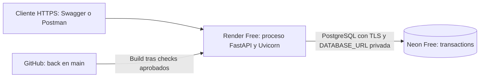

# Deployment y evidencias reales de la API

[Capítulo V](../../capitulos/05-implementacion.md) · [Guía del backend](https://github.com/1ASI0657-2620-9199/back/blob/main/DEPLOYMENT.md).

**Estado cloud: desplegado y verificado** el 10 de octubre de 2026.
API: https://finanzen-financial-records.onrender.com ·
[Swagger público](https://finanzen-financial-records.onrender.com/docs).
Render Free y Neon Free confirmados; deploy `live`, endpoints HTTP 200,
8 peticiones/11 aserciones Newman y persistencia comprobada tras reiniciar Render.
Consultar las [13 capturas públicas, grabación y registros cloud](publico/README.md).

Las evidencias locales anteriores se conservan en `local/`, capturadas
aproximadamente a las 03:15 America/Lima. Las públicas están en `publico/` y
documentan los recursos reales; el índice identifica el entorno de cada conjunto.

## Resultado de la validación local anterior

| Comprobación | Resultado | Archivo |
| --- | --- | --- |
| Backend SQLite + PostgreSQL real | 8 pruebas aprobadas, 0 fallos | [pytest.txt](local/pytest.txt) |
| Colección de Postman con Newman | 8 peticiones, 11 aserciones, 0 fallos | [Log](local/newman.txt) y [reporte JSON](local/newman.json) |
| Swagger en navegador Chrome | Peticiones HTTP reales, respuestas y capturas | [swagger-http.json](local/swagger-http.json) |
| Persistencia PostgreSQL | Mismos IDs después de detener y reiniciar el proceso Uvicorn | [persistencia.json](local/persistencia.json) |
| Grabación | Interacción real con Swagger y visualización de logs; sin narración | [demostracion.webm](local/demostracion.webm) |
| Entorno y commit | URL local, fecha UTC y backend `f218113` | [metadata.json](local/metadata.json) |
| GitHub Actions | Workflow del backend completado con éxito sobre `f218113` | [Estado consultado por API](local/github-actions.json) y [run público](https://github.com/1ASI0657-2620-9199/back/actions/runs/38037169861) |

Newman es el ejecutor de colecciones de Postman. Se identifica como tal; las
vistas de logs renderizadas no se presentan como capturas de Postman Desktop.
La grabación es una evidencia local sin voz; el equipo debe añadir la explicación
oral/enlace publicado si la entrega requiere ese formato.

## Capturas locales incorporadas

| Captura | Qué muestra | Apartado |
| --- | --- | --- |
| [01-newman.png](local/01-newman.png) | Vista de la salida real del runner Postman/Newman | 5.3.1.3 / 5.3.1.4 |
| [02-pytest.png](local/02-pytest.png) | Registro real de las ocho pruebas | 5.1.1 / 5.3.1.3 |
| [03-swagger-endpoints.png](local/03-swagger-endpoints.png) | Contrato, versión y operaciones de Swagger | 5.3.1.5 |
| [04-health.png](local/04-health.png) | Health ejecutado en Swagger, HTTP 200 | 5.3.1.4 / 5.3.1.5 |
| [05-create-income.png](local/05-create-income.png) | POST ejecutado, cabeceras, cuerpo y HTTP 201 | 5.3.1.4 / 5.3.1.5 |
| [06-list.png](local/06-list.png) | Dos movimientos del usuario de demostración | 5.3.1.4 / 5.3.1.5 |
| [07-summary.png](local/07-summary.png) | Resumen: ingresos 1000.00, gastos 125.50 y saldo 874.50 | 5.3.1.4 / 5.3.1.5 |
| [08-replay.png](local/08-replay.png) | Repetición del POST, mismo ID, HTTP 200 | 5.3.1.4 |
| [09-conflict.png](local/09-conflict.png) | Clave repetida con otro importe, HTTP 409 | 5.3.1.4 |
| [10-persistence.png](local/10-persistence.png) | Registro de IDs antes/después del reinicio local | 5.3.1.6 |
| [11-server-log.png](local/11-server-log.png) | Registro real del arranque y peticiones de Uvicorn | 5.3.1.6 |
| [12-github-actions.png](local/12-github-actions.png) | Página real de GitHub Actions: Success sobre `f218113` | 5.3.1.3 |
| [13-backend-commit.png](local/13-backend-commit.png) | Página real del commit que añade PostgreSQL y configuración gratuita | 5.3.1.2 |

## Arquitectura publicada

Esta vista representa los recursos desplegados. El [Blueprint gratuito](https://github.com/1ASI0657-2620-9199/back/blob/main/render.yaml)
fue validado contra el schema oficial de Render. La creación por la API de Render
aplicó la misma configuración Free; no se creó un disco o servicio de pago.
`DATABASE_URL` se configuró como variable privada.
El servidor impide usar SQLite efímero si detecta ejecución en Render sin esa variable.

Los datos quedan en Neon. La [prueba remota](publico/persistencia.json) confirma
IDs, saldo e idempotencia después de reiniciar Render, además de la prueba local.

Según los límites consultados, Neon Free incluye 1 GB y 100 CU-horas por
proyecto/mes, y Render Free puede dormir tras 15 minutos de inactividad. Se
mantienen los planes gratuitos y sus cuotas. [Neon Free](https://neon.com/blog/neon-free-plan-1-gb-per-project),
[Render Free](https://render.com/docs/free).

## Evidencias cloud obtenidas

Ya se incorporaron URL HTTPS real, estado `live`, ID de deploy, commit publicado,
logs de build/runtime, peticiones y capturas públicas, además de persistencia
después del reinicio. El [índice cloud](publico/README.md) relaciona cada evidencia
con los puntos del capítulo V.

Los apartados de colaboración, Kanban, BDD y librería propia requieren sus
actividades reales; estas capturas técnicas no los reemplazan.

## Reproducir capturas

El script [capturar_evidencia_navegador.cjs](../../scripts/capturar_evidencia_navegador.cjs)
requiere Node.js, Chrome, Playwright, Newman y un PostgreSQL local de pruebas.
Instalar las herramientas de captura fuera del backend para no añadirlas a
las dependencias de producción. El script arranca un Uvicorn temporal local,
ejecuta pruebas, captura Swagger y verifica un reinicio; utiliza datos de muestra.

Para un servicio publicado, configurar `FINANZEN_EVIDENCE_BASE_URL` con la URL
HTTPS real. En ese modo no arranca un servidor local ni reinicia el remoto:
la persistencia remota se debe verificar mediante la integración del proveedor.
Las credenciales de PostgreSQL no se incluyen en los registros de captura.
